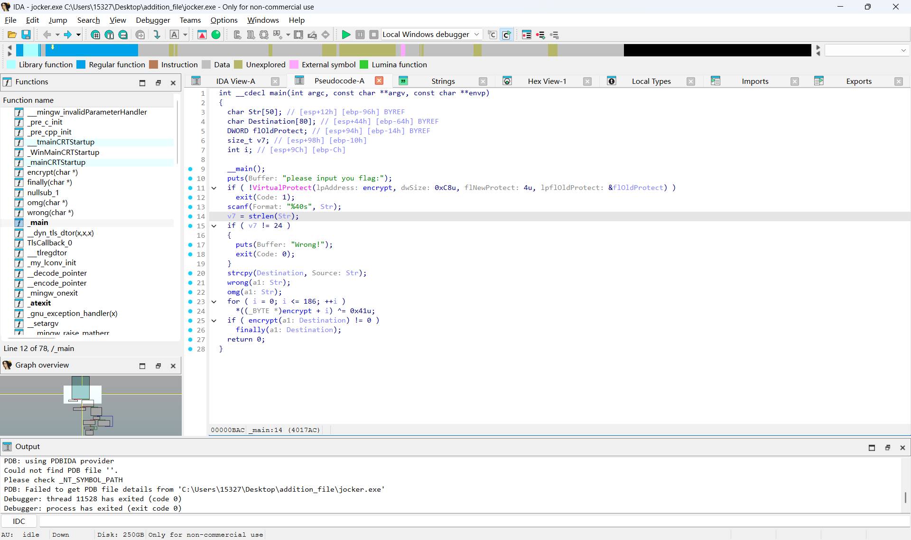
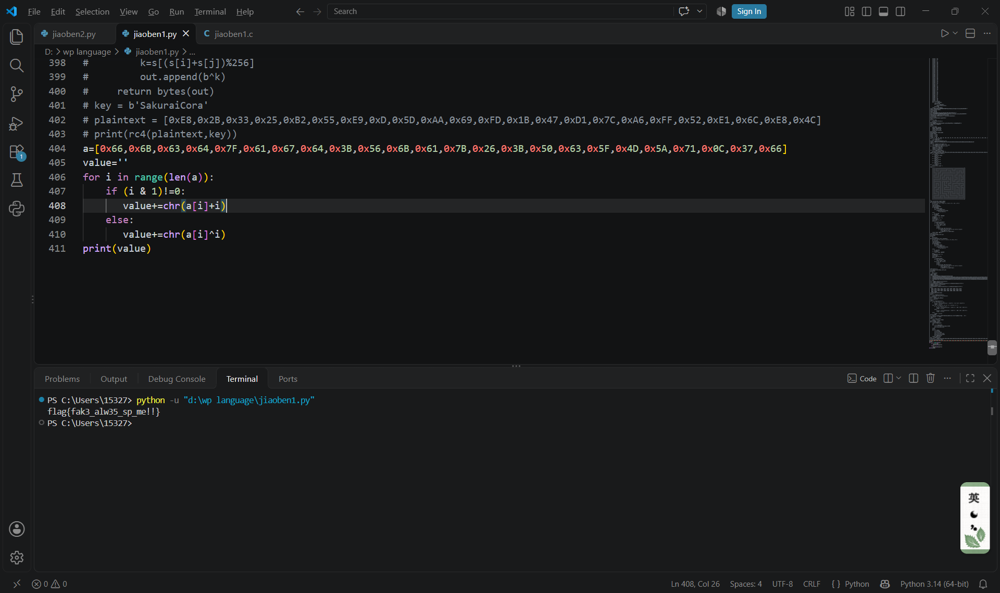
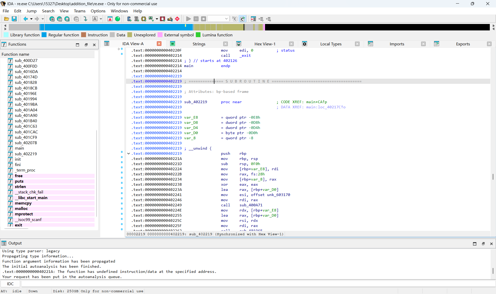
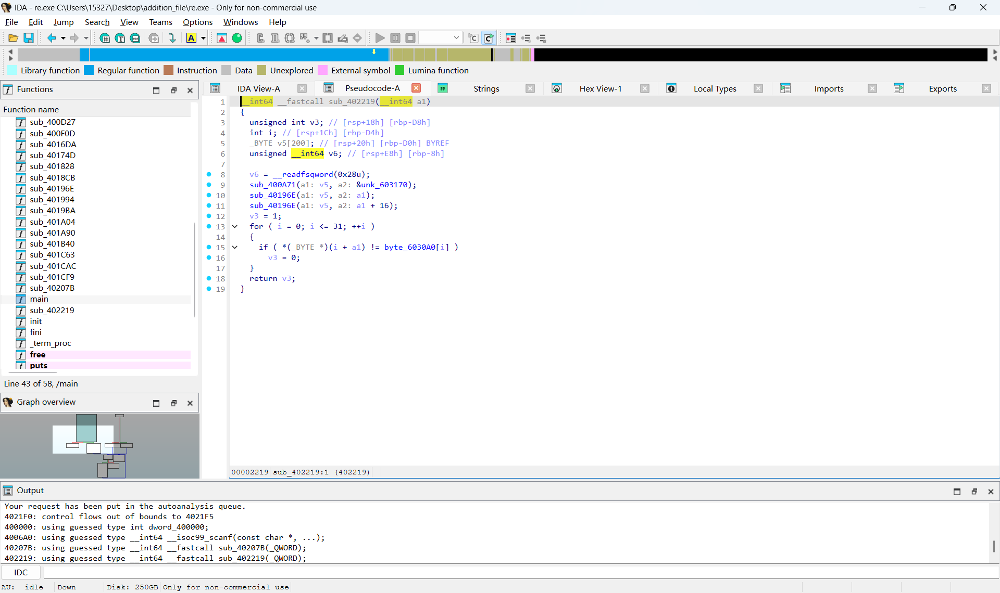
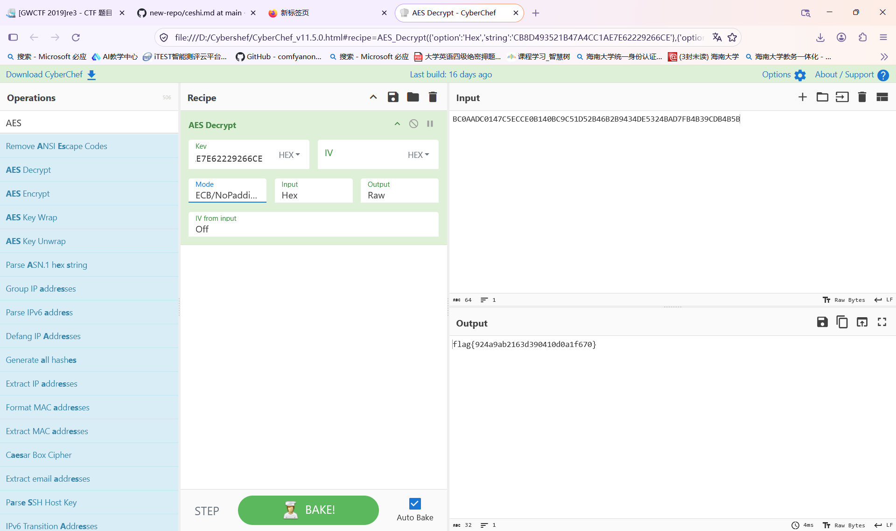
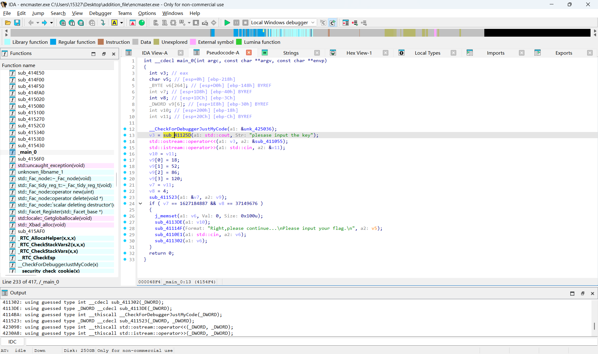
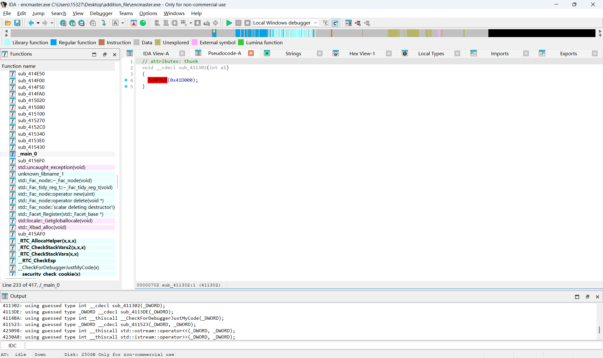
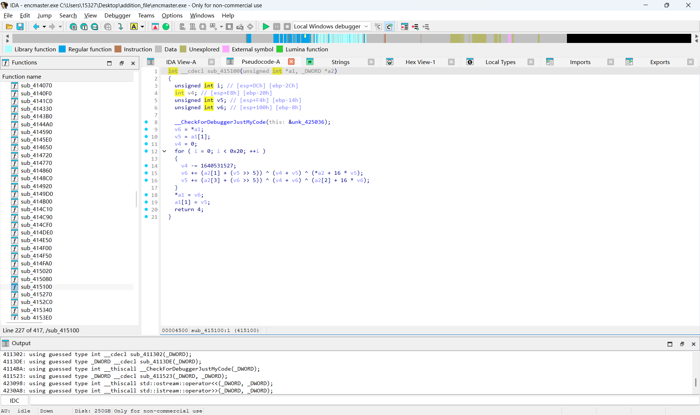
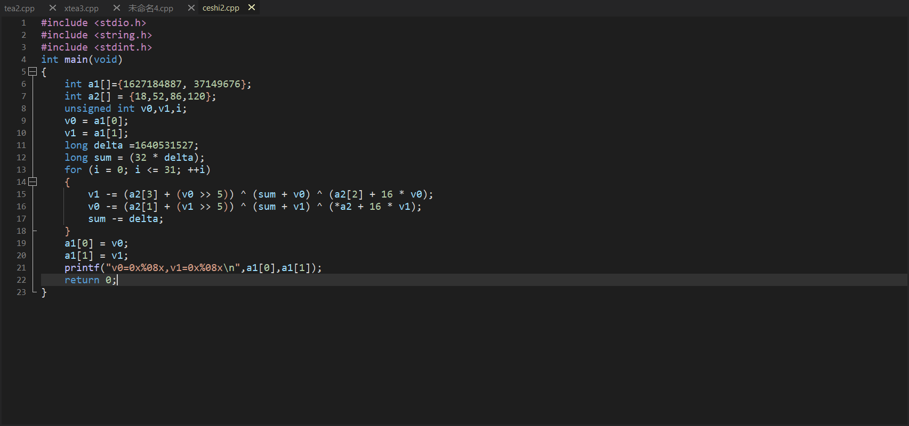

### SMC,IDC 脚本
SMC是代码自修改，也就是在执行之前先修改代码的内容，使原有的内存指令发生变化  
具体的执行过程:
先调用VirtualProtect：把代码段权限从「只读 + 可执行」改成**可写**
解密循环，把这块乱码原地解密，**覆盖改写内存里的指令**
再改回权限，然后 **jmp /call 跳过去执行刚解密出来的真实代码**
举一个例子
#include <stdio.h>  
#include <windows.h>  
void anti_debug() {  
    unsigned char *code = (unsigned char *)anti_debug;  
    DWORD oldProtect;  
    if (!VirtualProtect(code, 1, PAGE_EXECUTE_READWRITE, &oldProtect)) {  
        return;  
    }  
    code[0] = 0xCC;  
    VirtualProtect(code, 1, oldProtect, &oldProtect);  
}  
int main() {  
    printf("Running normal code...\n");  
    anti_debug();  
    printf("This line will not be reached if under debugger.\n");  
    return 0;  
}
if (!VirtualProtect(code, 1, PAGE_EXECUTE_READWRITE, &oldProtect)) {
        return;
    } 这一段是修改权限
code[0] = 0xCC;    这一段是写入断点
VirtualProtect(code, 1, oldProtect, &oldProtect); 这一段是恢复权限  
IDC就是IDA的内置脚本语言，直接自动执行某些操作，比如说批量重命名函数、变量，自动 Patch 字节，提取字符串，交叉引用等
举一个例子  
Nop掉所有指令  
#include <idc.idc>  
static NopRange(start, end)  
{  
    auto ea;  
    for(ea = start; ea < end; ea++)  
    {  
        PatchByte(ea, 0x90);  
    }  
    MakeCode(start);  
    Refresh();  
    Message("NOP done: 0x%X ~ 0x%X\n", start, end);  
}
static main()
{
    auto START = 0x401050;
    auto END   = 0x401078;
    NopRange(START, END);
}
这里拿一些经典题目作为SMC的实例  
#### [网鼎杯 2020 青龙组]jocker
打开后首先发现有红色报错，提示sp-anaysis-failed。F5也有红色报错。sp表示栈偏移，只有call指令的esp变化能和ida的计算结果对应上，(sp的偏移量前后对应)栈才能处于平衡状态  

这里报错内容表明此时栈没有平衡，为了平衡必须修改sp偏移量的值，把2个call指令的sp都改为零，函数就能有效平衡栈，此时再生成伪代码发现没有报错  

直接跟进wrong和omg两个函数，有加密逻辑，和enc密文，但是注释文字告诉你是不对的，手解一遍发现还真是错误的flag

问题出在smc上，for ( i = 0; i <= 186; ++i ),*((_BYTE *)encrypt + i) ^= 0x41u;这两行即为自修改smc，也就是说执行完自修改后的函数才是正确的
必须使用动态调试，在smc执行完之后重新获得新的函数，在smc之前下断点即可

执行完这187次smc后得到函数
int __cdecl encrypt(char *a1)  
{    
  int v2[19]; // [sp+1Ch] [bp-6Ch]@1  
  int v3; // [sp+68h] [bp-20h]@1  
  int i; // [sp+6Ch] [bp-1Ch]@1  
  v3 = 1;
  qmemcpy(v2, &amp;unk_403040, sizeof(v2));  
  for ( i = 0; i <= 18; ++i )  
  {  
    if ( (char)(a1[i] ^ aHahahaha_do_yo[i]) != v2[i] )  
    {  
      puts("wrong ~");  
      v3 = 0;  
      exit(0);  
    }  
  }  
  if ( v3 == 1 )  
    puts("come here");  
  return v3;  
}  
跟进unk_403040,v2能找到密文，函数的加密过程已经给了，解密过程反过来执行
#include<stdio.h>
#include<string.h>
int main(){
  char v3[9]="%tp&:"; 
  char v4; 
    char Buffer[]="hahahaha_do_you_find_me?";
    int v2[19]={14, 13, 9, 6, 19, 5, 88, 86, 62, 6, 12, 60, 31, 87, 20, 107, 87, 89, 13};
    char a1[19];
    for (  int i= 0; i <= 18; ++i ){
        a1[i]=v2[i]^Buffer[i];
        printf("%c",a1[i]);
    }
    for(int i= 0; i < 5; ++i  ){
        v4=v3[i]^71;
        printf("%c",v4);
    }
    return 0;
}
#### [GWCTF 2019]re3
发现sub_401129里面的函数无法再跟随了。for ( i = 0; i <= 223; ++i )*((_BYTE *)sub_402219 + i) ^= 0x99u;这两句是明显的smc语句  

按理说使用动态调试走完smc，但是循环太多了，借鉴别人写的一个idc脚本，自动执行这两句  

#include <idc.idc>  
static main()  
{  
    auto addr = 0x402219;  
    auto i = 0;  
    for(i=0;i<=223;i++)  
    {  
        PatchByte(addr+i,Byte(addr+i)^0x99);  
    }  
}  
运行完脚本，再找到sub_401129，在ida view里先按F转为未定义，再按P重新定义，出现机器码和var标记，再跟进sub_40196E函数寻找线索  

跟进了半天发现在函数sub_400BAC里有byte_4023A0数组，我并不知道这个数组是干啥用的，查看了别的题解才发现这是AES算法的S盒，AES就是根据盒进行逐字节的代换操作，而模式默认是ECB，偏移默认没有偏移  

主函数里的byte_6030A0应该就是密文，跟进得到BC0AADC0147C5ECCE0B140BC9C51D52B46B2B9434DE5324BAD7FB4B39CDB4B5B，还剩下密钥  
真正执行AES的最外层函数还是sub_40196E，所以sub_40196E(v4,a1)里的v4应该是密钥，直接跟进并没有，需要动态调试获得密钥CB8D493521B47A4CC1AE7E62229266CE  
有了密钥和密文，明确算法是AES，可以用工具解密了  

记一下AES的S盒    
#### [HDCTF 2023]enc
打开，生成伪代码，检查是否存在SMC。发现跟进sub_411302出现红色报错，在IDA view里检查发现并没有报错，这里应该就是SMC  

跟进sub_411523后发现里面是一个TEA加密函数，而且是标准版，但是在函数里面没有找到密文和密钥，在主函数找到密钥和密文进行解密  

关键是如何去除SMC，由于没有明确的代码，不能直接使用IDC脚本去除。只能用动态调试  
动态调试后在跟进sub_411302，重新生成新的函数，生成伪代码
int __cdecl sub_41D000(char *Str)  
{  
  char v2; // [esp+0h] [ebp-558h]  
  size_t m; // [esp+190h] [ebp-3C8h]  
  BOOL v4; // [esp+19Ch] [ebp-3BCh]  
  int k; // [esp+1A8h] [ebp-3B0h]  
  int v6; // [esp+1B4h] [ebp-3A4h]  
  int v7; // [esp+1C0h] [ebp-398h]  
  int i; // [esp+1CCh] [ebp-38Ch]  
  int j; // [esp+1CCh] [ebp-38Ch]  
  int v10; // [esp+1CCh] [ebp-38Ch]  
  char v11; // [esp+1DBh] [ebp-37Dh]  
  char v12; // [esp+1DBh] [ebp-37Dh]  
  char v13[540]; // [esp+1E4h] [ebp-374h]  
  char v14[24]; // [esp+400h] [ebp-158h] BYREF  
  int v15; // [esp+418h] [ebp-140h]  
  char v16[264]; // [esp+424h] [ebp-134h] BYREF  
  char v17[40]; // [esp+52Ch] [ebp-2Ch] BYREF  
  __CheckForDebuggerJustMyCode(&unk_425036);  
  v17[0] = 15;  
  v17[1] = -108;  
  v17[2] = -82;  
  ....  
  j_memset(v16, 0, 0x100u);  
  v15 = j_strlen(Str);  
  strcpy(v14, "you_are_master");  
  v13[531] = 0;  
  ......  
  if ( v4 )
    return sub_41114F("right!!!!", v2);
  else
    return sub_41114F("please try agin~", v2);
}  
根据伪代码内容应该是使用RC4算法，v17是密文，you_are_master是密钥，即可解密。
