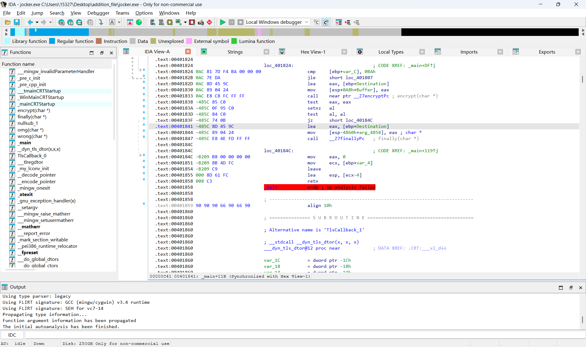

[网鼎杯 2020 青龙组]jocker
打开后首先发现有红色报错，提示sp-anaysis-failed。F5也有红色报错。sp表示栈偏移，只有call指令的esp变化能和ida对应上，(sp的偏移量前后对应)栈才能处于平衡状态  

这里报错内容表明此时栈没有平衡，为了平衡必须修改sp偏移量的值，把2个call指令的sp都改为零，函数就能有效平衡栈，此时再生成伪代码发现没有报错  

直接跟进wrong和omg两个函数，有加密逻辑，和enc密文，但是注释文字告诉你是不对的，手解一遍发现还真是错误的flag

问题出在smc上，for ( i = 0; i <= 186; ++i ),*((_BYTE *)encrypt + i) ^= 0x41u;这两行即为自修改smc，也就是说执行完自修改后的函数才是正确的
必须使用动态调试，在smc执行完之后重新获得新的函数，在smc之前下断点即可

执行完这187次smc后得到函数
int __cdecl encrypt(char *a1)  
{    
  int v2[19]; // [sp+1Ch] [bp-6Ch]@1  
  int v3; // [sp+68h] [bp-20h]@1  
  int i; // [sp+6Ch] [bp-1Ch]@1  

  v3 = 1;
  qmemcpy(v2, &amp;unk_403040, sizeof(v2));  
  for ( i = 0; i <= 18; ++i )  
  {  
    if ( (char)(a1[i] ^ aHahahaha_do_yo[i]) != v2[i] )  
    {  
      puts("wrong ~");  
      v3 = 0;  
      exit(0);  
    }  
  }  
  if ( v3 == 1 )  
    puts("come here");  
  return v3;  
}  
跟进unk_403040,v2能找到密文，函数的加密过程已经给了，解密过程反过来执行
#include<stdio.h>
#include<string.h>
int main(){
  char v3[9]="%tp&:"; 
  char v4; 
    char Buffer[]="hahahaha_do_you_find_me?";
    int v2[19]={14, 13, 9, 6, 19, 5, 88, 86, 62, 6, 12, 60, 31, 87, 20, 107, 87, 89, 13};
    char a1[19];
    for (  int i= 0; i <= 18; ++i ){
        a1[i]=v2[i]^Buffer[i];
        printf("%c",a1[i]);
    }
    for(int i= 0; i < 5; ++i  ){
        v4=v3[i]^71;
        printf("%c",v4);
    }
    return 0;
}
