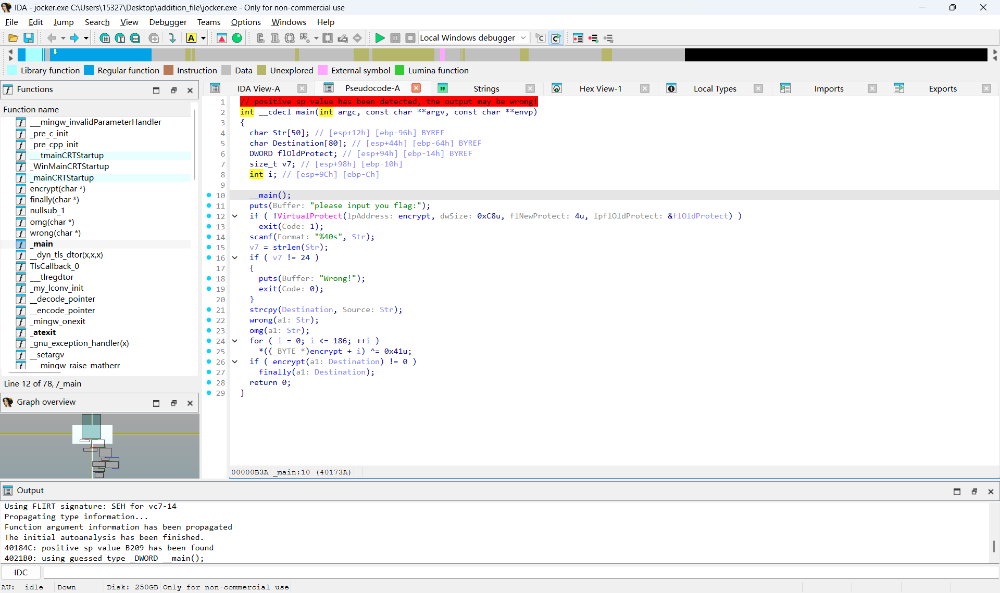
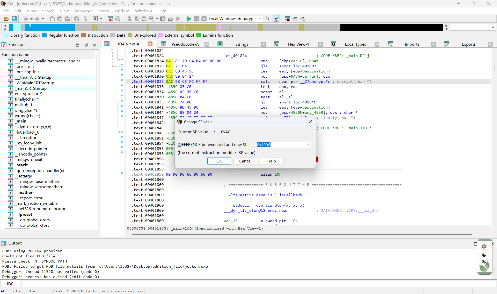
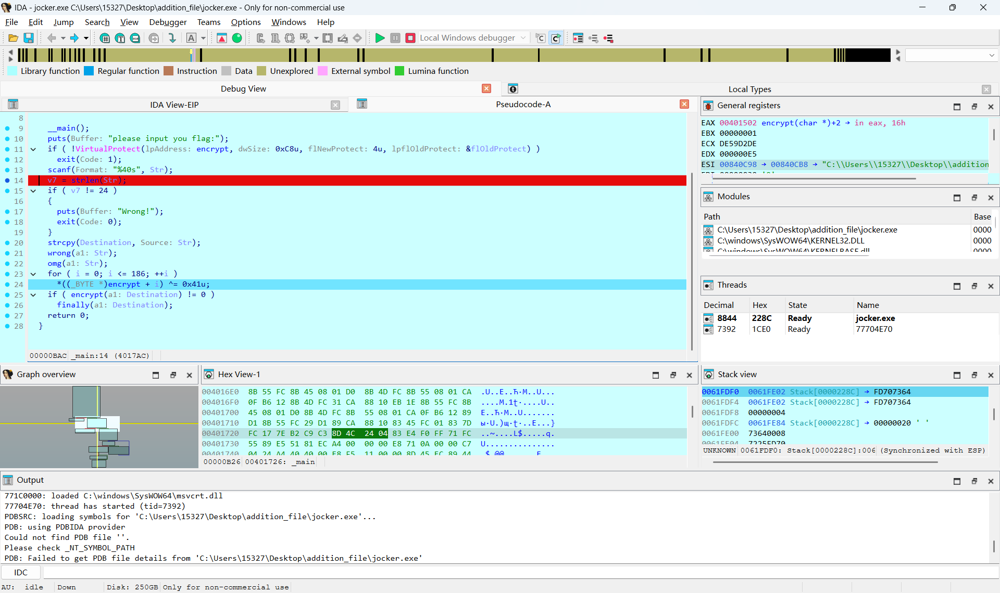
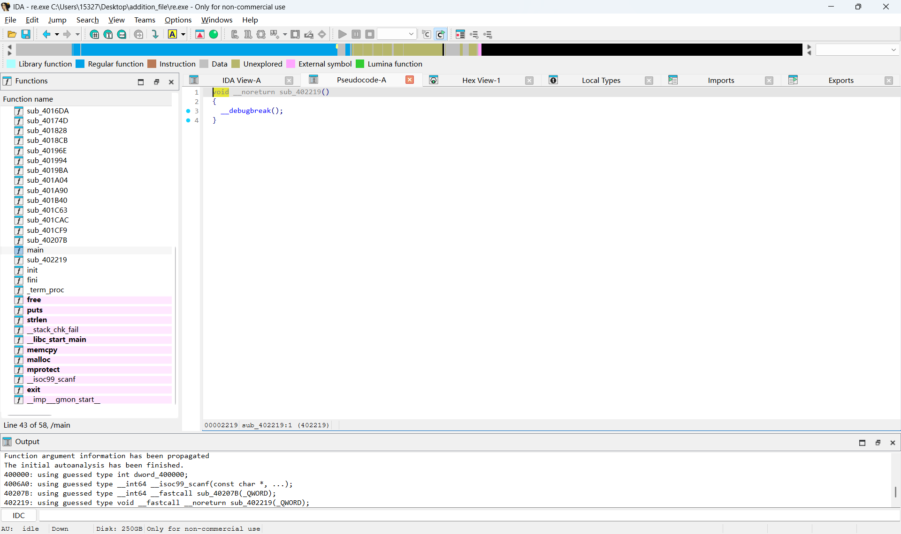
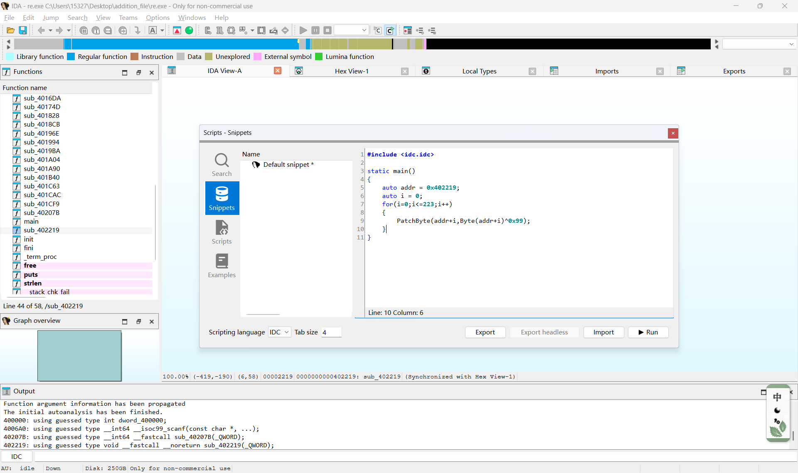
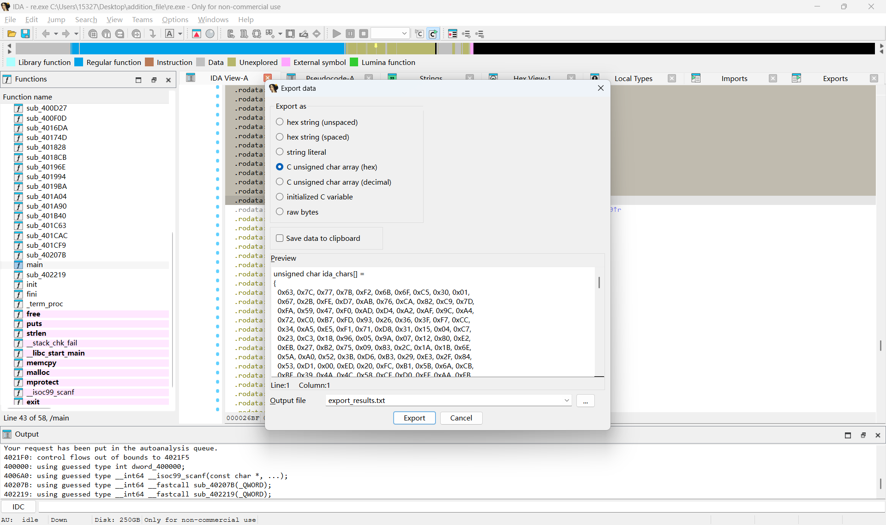

### SMC,IDC 脚本
SMC是代码自修改，也就是在执行之前先修改代码的内容，使原有的内存指令发生变化  
具体的执行过程:
先调用VirtualProtect：把代码段权限从「只读 + 可执行」改成**可写**
解密循环，把这块乱码原地解密，**覆盖改写内存里的指令**
再改回权限，然后 **jmp /call 跳过去执行刚解密出来的真实代码**
举一个例子
#include <stdio.h>  
#include <windows.h>  
void anti_debug() {  
    unsigned char *code = (unsigned char *)anti_debug;  
    DWORD oldProtect;  
    if (!VirtualProtect(code, 1, PAGE_EXECUTE_READWRITE, &oldProtect)) {  
        return;  
    }  
    code[0] = 0xCC;  
    VirtualProtect(code, 1, oldProtect, &oldProtect);  
}  
int main() {  
    printf("Running normal code...\n");  
    anti_debug();  
    printf("This line will not be reached if under debugger.\n");  
    return 0;  
}
if (!VirtualProtect(code, 1, PAGE_EXECUTE_READWRITE, &oldProtect)) {
        return;
    } 这一段是修改权限
code[0] = 0xCC;    这一段是写入断点
VirtualProtect(code, 1, oldProtect, &oldProtect); 这一段是恢复权限  
IDC就是IDA的内置脚本语言，直接自动执行某些操作，比如说批量重命名函数、变量，自动 Patch 字节，提取字符串，交叉引用等
举一个例子  
Nop掉所有指令  
#include <idc.idc>  
static NopRange(start, end)  
{  
    auto ea;  
    for(ea = start; ea < end; ea++)  
    {  
        PatchByte(ea, 0x90);  
    }  
    MakeCode(start);  
    Refresh();  
    Message("NOP done: 0x%X ~ 0x%X\n", start, end);  
}
static main()
{
    auto START = 0x401050;
    auto END   = 0x401078;
    NopRange(START, END);
}
这里拿一些经典题目作为SMC的实例  
#### [网鼎杯 2020 青龙组]jocker
打开后首先发现有红色报错，提示sp-anaysis-failed。F5也有红色报错。sp表示栈偏移，只有call指令的esp变化能和ida的计算结果对应上，(sp的偏移量前后对应)栈才能处于平衡状态  

这里报错内容表明此时栈没有平衡，为了平衡必须修改sp偏移量的值，把2个call指令的sp都改为零，函数就能有效平衡栈，此时再生成伪代码发现没有报错  

直接跟进wrong和omg两个函数，有加密逻辑，和enc密文，但是注释文字告诉你是不对的，手解一遍发现还真是错误的flag

问题出在smc上，for ( i = 0; i <= 186; ++i ),*((_BYTE *)encrypt + i) ^= 0x41u;这两行即为自修改smc，也就是说执行完自修改后的函数才是正确的
必须使用动态调试，在smc执行完之后重新获得新的函数，在smc之前下断点即可

执行完这187次smc后得到函数
int __cdecl encrypt(char *a1)  
{    
  int v2[19]; // [sp+1Ch] [bp-6Ch]@1  
  int v3; // [sp+68h] [bp-20h]@1  
  int i; // [sp+6Ch] [bp-1Ch]@1  

  v3 = 1;
  qmemcpy(v2, &amp;unk_403040, sizeof(v2));  
  for ( i = 0; i <= 18; ++i )  
  {  
    if ( (char)(a1[i] ^ aHahahaha_do_yo[i]) != v2[i] )  
    {  
      puts("wrong ~");  
      v3 = 0;  
      exit(0);  
    }  
  }  
  if ( v3 == 1 )  
    puts("come here");  
  return v3;  
}  
跟进unk_403040,v2能找到密文，函数的加密过程已经给了，解密过程反过来执行
#include<stdio.h>
#include<string.h>
int main(){
  char v3[9]="%tp&:"; 
  char v4; 
    char Buffer[]="hahahaha_do_you_find_me?";
    int v2[19]={14, 13, 9, 6, 19, 5, 88, 86, 62, 6, 12, 60, 31, 87, 20, 107, 87, 89, 13};
    char a1[19];
    for (  int i= 0; i <= 18; ++i ){
        a1[i]=v2[i]^Buffer[i];
        printf("%c",a1[i]);
    }
    for(int i= 0; i < 5; ++i  ){
        v4=v3[i]^71;
        printf("%c",v4);
    }
    return 0;
}
#### [GWCTF 2019]re3
发现sub_401129里面的函数无法再跟随了。for ( i = 0; i <= 223; ++i )*((_BYTE *)sub_402219 + i) ^= 0x99u;这两句是明显的smc语句  

按理说使用动态调试走完smc，但是循环太多了，借鉴别人写的一个idc脚本，自动执行这两句  

#include <idc.idc>  
static main()  
{  
    auto addr = 0x402219;  
    auto i = 0;  
    for(i=0;i<=223;i++)  
    {  
        PatchByte(addr+i,Byte(addr+i)^0x99);  
    }  
}  
运行完脚本，再找到sub_401129，在ida view里先按F转为未定义，再按P重新定义，出现机器码和var标记，再跟进sub_40196E函数寻找线索  

跟进了半天发现在函数sub_400BAC里有byte_4023A0数组，我并不知道这个数组是干啥用的，查看了别的题解才发现这是AES算法的S盒，AES就是根据盒进行逐字节的代换操作，而模式默认是ECB，偏移默认没有偏移  

主函数里的byte_6030A0应该就是密文，跟进得到BC0AADC0147C5ECCE0B140BC9C51D52B46B2B9434DE5324BAD7FB4B39CDB4B5B，还剩下密钥  
真正执行AES的最外层函数还是sub_40196E，所以sub_40196E(v4,a1)里的v4应该是密钥，直接跟进并没有，需要动态调试获得密钥CB8D493521B47A4CC1AE7E62229266CE  
有了密钥和密文，明确算法是AES，可以用工具解密了  

记一下AES的S盒  
  0x63, 0x7C, 0x77, 0x7B, 0xF2, 0x6B, 0x6F, 0xC5, 0x30, 0x01,   
  0x67, 0x2B, 0xFE, 0xD7, 0xAB, 0x76, 0xCA, 0x82, 0xC9, 0x7D,   
  0xFA, 0x59, 0x47, 0xF0, 0xAD, 0xD4, 0xA2, 0xAF, 0x9C, 0xA4,   
  0x72, 0xC0, 0xB7, 0xFD, 0x93, 0x26, 0x36, 0x3F, 0xF7, 0xCC,   
  0x34, 0xA5, 0xE5, 0xF1, 0x71, 0xD8, 0x31, 0x15, 0x04, 0xC7,   
  0x23, 0xC3, 0x18, 0x96, 0x05, 0x9A, 0x07, 0x12, 0x80, 0xE2,   
  0xEB, 0x27, 0xB2, 0x75, 0x09, 0x83, 0x2C, 0x1A, 0x1B, 0x6E,   
  0x5A, 0xA0, 0x52, 0x3B, 0xD6, 0xB3, 0x29, 0xE3, 0x2F, 0x84,   
  0x53, 0xD1, 0x00, 0xED, 0x20, 0xFC, 0xB1, 0x5B, 0x6A, 0xCB,   
  0xBE, 0x39, 0x4A, 0x4C, 0x58, 0xCF, 0xD0, 0xEF, 0xAA, 0xFB,   
  0x43, 0x4D, 0x33, 0x85, 0x45, 0xF9, 0x02, 0x7F, 0x50, 0x3C,   
  0x9F, 0xA8, 0x51, 0xA3, 0x40, 0x8F, 0x92, 0x9D, 0x38, 0xF5,   
  0xBC, 0xB6, 0xDA, 0x21, 0x10, 0xFF, 0xF3, 0xD2, 0xCD, 0x0C,   
  0x13, 0xEC, 0x5F, 0x97, 0x44, 0x17, 0xC4, 0xA7, 0x7E, 0x3D,   
  0x64, 0x5D, 0x19, 0x73, 0x60, 0x81, 0x4F, 0xDC, 0x22, 0x2A,   
  0x90, 0x88, 0x46, 0xEE, 0xB8, 0x14, 0xDE, 0x5E, 0x0B, 0xDB,   
  0xE0, 0x32, 0x3A, 0x0A, 0x49, 0x06, 0x24, 0x5C, 0xC2, 0xD3,   
  0xAC, 0x62, 0x91, 0x95, 0xE4, 0x79, 0xE7, 0xC8, 0x37, 0x6D,   
  0x8D, 0xD5, 0x4E, 0xA9, 0x6C, 0x56, 0xF4, 0xEA, 0x65, 0x7A,   
  0xAE, 0x08, 0xBA, 0x78, 0x25, 0x2E, 0x1C, 0xA6, 0xB4, 0xC6,   
  0xE8, 0xDD, 0x74, 0x1F, 0x4B, 0xBD, 0x8B, 0x8A, 0x70, 0x3E,   
  0xB5, 0x66, 0x48, 0x03, 0xF6, 0x0E, 0x61, 0x35, 0x57, 0xB9,    
  0x86, 0xC1, 0x1D, 0x9E, 0xE1, 0xF8, 0x98, 0x11, 0x69, 0xD9,   
  0x8E, 0x94, 0x9B, 0x1E, 0x87, 0xE9, 0xCE, 0x55, 0x28, 0xDF,   
  0x8C, 0xA1, 0x89, 0x0D, 0xBF, 0xE6, 0x42, 0x68, 0x41, 0x99,   
  0x2D, 0x0F, 0xB0, 0x54, 0xBB, 0x16  
