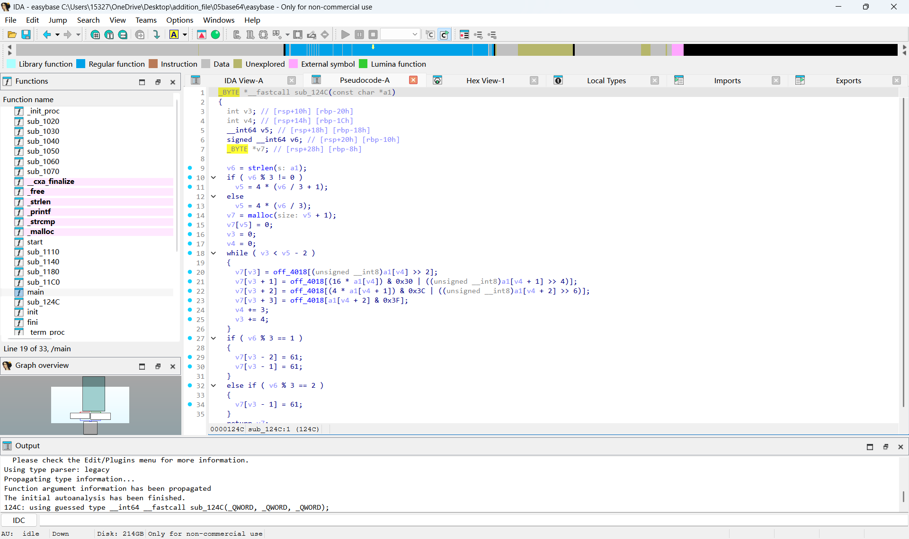
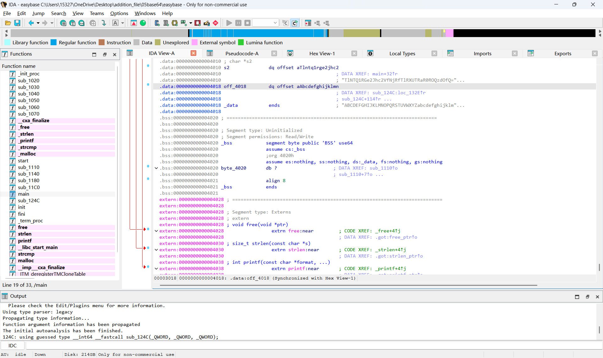
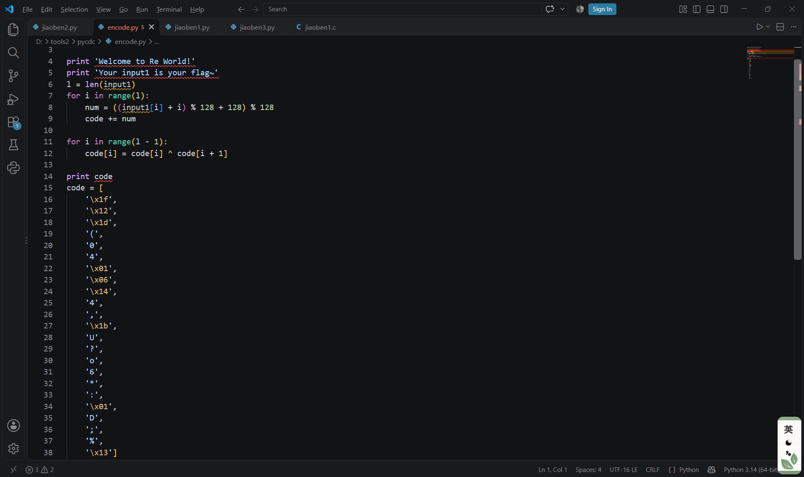
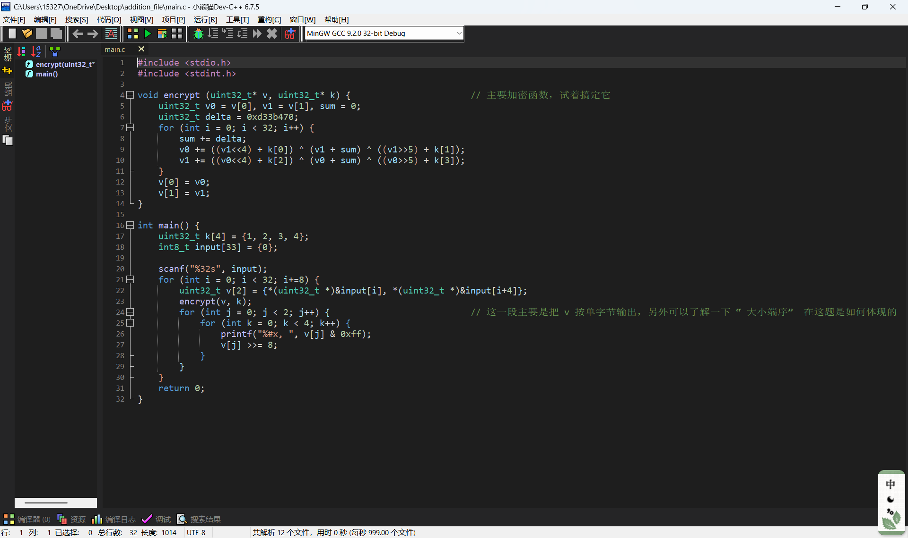
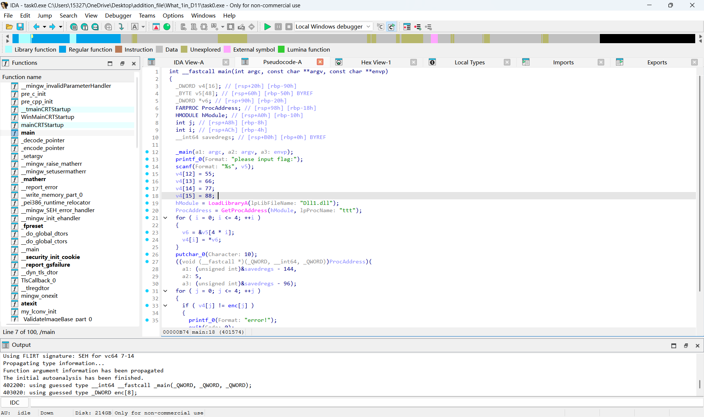
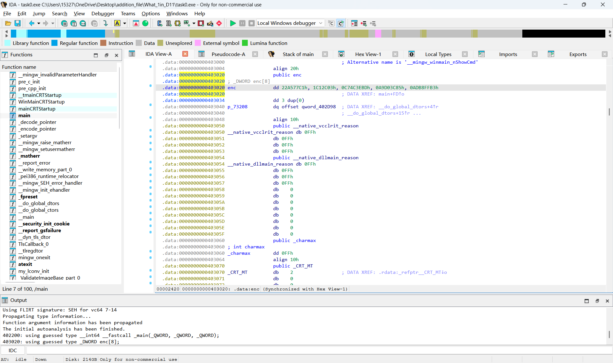
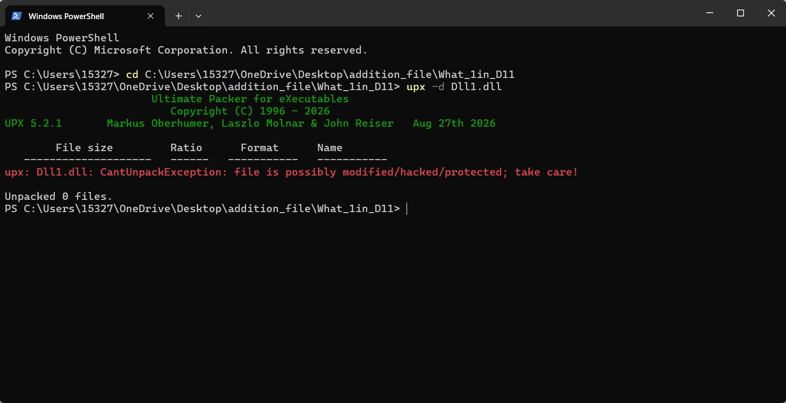
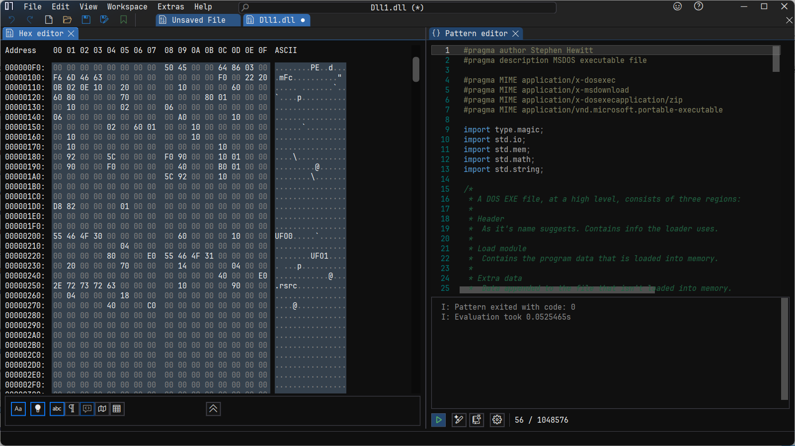
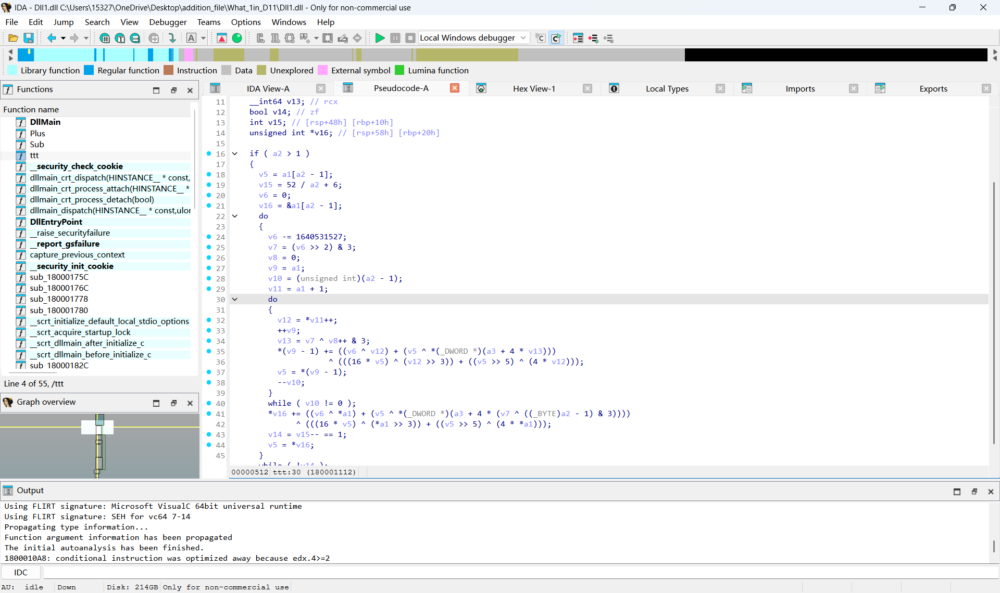

### 基础算法
#### BSAE64
BSAE64:使用64个字符来表示二进制数据  
编码过程主要是:原始二进制每三个字节(24位数据)是一组，把这24个数据分为4*6个段，每一段进行字符映射(对应一个BASE64字符)    
BASE64关键在于识别，平时见到**&0x3f**，**&0x3c**,**>>6**,**%64**等操作就能判断是BASE64了，解题并不需要写编码的语言，直接使用python第三方库    
一般而言，码表是**ABCDEFGHIJKLMNOPQRSTUVWXYZabcdefghijklmnopqrstuvwxyz0123456789+/**，不过有时候存在码表替换，需要在伪代码里自己找哪一个字节的值是新码表
#### TEA,XTEA(摘自https://www.cnblogs.com/zpchcbd/p/15974293.html)  
TEA：是一种分组加密算法  
以原文以**8字节**（64位bit）为一组，密钥**16字节**（128位bit）为一组，（char为1字节，int为4字节，double为8字节）主要运算为加法运算，位运算，异或运算  
首先从两边各自传入四个字节  
右边传入的4个字节，节称呼为M，M进行了三个部分的操作，M左移4位与密钥[0]相加，M右移5位与密钥[1]相加，M与δ相加，最后这三个算出的值再异或  
左边传入的4个字节，这里将这4个字节称呼为N，N=N+M  
同理再对N进行同样的操作，再令M=M+N
C代码：**其中v是待加密字段，k是密钥**
#include <stdio.h>  
#include <stdint.h>  
void encrypt (uint32_t* v, uint32_t* k) {  
uint32_t v0=v[0], v1=v[1], sum=0, i;          
    uint32_t delta=0x9e3779b9;                   
uint32_t k0=k[0], k1=k[1], k2=k[2], k3=k[3];     
    for (i=0; i < 32; i++) {                        
        sum += delta;  
        v0 += ((v1<<4) + k0) ^ (v1 + sum) ^ ((v1>>5) + k1);
        v1 += ((v0<<4) + k2) ^ (v0 + sum) ^ ((v0>>5) + k3);
    }                                              
    v[0]=v0; v[1]=v1;
}
void decrypt (uint32_t* v, uint32_t* k) {  
    uint32_t v0=v[0], v1=v[1], sum=0xC6EF3720, i;    
    uint32_t delta=0x9e3779b9;                       
    uint32_t k0=k[0], k1=k[1], k2=k[2], k3=k[3];     
    for (i=0; i<32; i++) {                           
        v1 -= ((v0<<4) + k2) ^ (v0 + sum) ^ ((v0>>5) + k3);  
        v0 -= ((v1<<4) + k0) ^ (v1 + sum) ^ ((v1>>5) + k1);  
        sum -= delta;
    }                                               
    v[0]=v0; v[1]=v1;  
}  
int main()  
{  
uint32_t v[2]={1,2},k[4]={2,2,3,4};  
printf("原始数据：%u %u\n",v[0],v[1]);  
    encrypt(v, k);  
    printf("加密后数据：%u %u\n",v[0],v[1]);  
    decrypt(v, k);  
    printf("解密后数据：%u %u\n",v[0],v[1]);  
    return 0;  
}  
XTEA:是TEA的加强版
XTEA使用了相同的加法运算，位运算，异或运算。但是触发顺序不同，这里指**四个子密钥的混合方式与原来不同**，所以运算的顺序也不同
C代码**其中v是待加密字段，k是密钥**  
#include <stdio.h>  
#include <stdint.h>  
void encipher(unsigned int num_rounds, uint32_t v[2], uint32_t const key[4]) {  
    unsigned int i;  
    uint32_t v0=v[0], v1=v[1], sum=0, delta=0x9E3779B9;  
    for (i=0; i < num_rounds; i++) {  
        v0 += (((v1 << 4) ^ (v1 >> 5)) + v1) ^ (sum + key[sum & 3]);  
        sum += delta;  
        v1 += (((v0 << 4) ^ (v0 >> 5)) + v0) ^ (sum + key[(sum>>11) & 3]);  
    }  
    v[0]=v0; v[1]=v1;  
}  
void decipher(unsigned int num_rounds, uint32_t v[2], uint32_t const key[4]) {  
    unsigned int i;  
    uint32_t v0=v[0], v1=v[1], delta=0x9E3779B9, sum=delta*num_rounds;  
    for (i=0; i < num_rounds; i++) {  
        v1 -= (((v0 << 4) ^ (v0 >> 5)) + v0) ^ (sum + key[(sum>>11) & 3]);  
        sum -= delta;  
        v0 -= (((v1 << 4) ^ (v1 >> 5)) + v1) ^ (sum + key[sum & 3]);  
    }  
    v[0]=v0; v[1]=v1;  
}  
int main()  
{  
    uint32_t v[2]={1,2};  
    uint32_t const k[4]={2,2,3,4};  
    unsigned int r=32;  
    printf("原始数据：%u %u\n",v[0],v[1]);  
    encipher(r, v, k);  
    printf("加密后数据：%u %u\n",v[0],v[1]);  
    decipher(r, v, k);  
    printf("解密后数据：%u %u\n",v[0],v[1]);  
    return 0;  
}  
仔细地观察两组代码，**发现for循环里对每一次取两位的待加密/解密字段的运算是不一样的，密钥下标取的也不一样**，这个得具体放到题目里去分析，后面写题解也会提及   
#### RSA
RSA是一种非对称加密，使用**一对公钥和一对私钥**加密和解密，它涉及到一些数学知识  
如果p,q是两个不同的素数，n=p*q  
欧拉函数**φn=(p-1)(q-1)**，意义是小于n，且和n互质的整数的个数  
密钥的选取  
选两个素数p,q,**必须满足p<q**  
n=p*q  
欧拉函数φn=(p-1)(q-1)  
选取公钥e **1<e<φn**，且gcd(e,φn)=1  
选取私钥d e.d===1，即**d是e在模φn的模逆元**  
如果明文是m 
加密: **c=m的e次方mod n**  
解密: **m=c的d次方mod n**  
python代码  
import math  
def gcd(a,b):  
    while b:  
        a,b=b,a%b  
    return a  
def modinv(a,m):  
    g,x,y=extended_gcd(a,m)  
    if g!=1:  
        raise Exception('逆元不存在')  
    else:  
        return x%m  
def extended_gcd(a,b):  
    if b==0:  
        return (a,1,0)  
    else:  
        g,x1,y1=extended_gcd(b,a%b)  
        x = y1  
        y = x1-(a//b) * y1  
        return (g,x,y)  
def rsa_encrypt(m,e,n):  
    return pow(m,e,n)  
def rsa_decrypt(c,d,n):  
    return pow(c,d,n)  
p=11  
q=13  
n=p*q  
ola=(p-1)*(q-1)  
e=7  
d=modinv(e,ola)  
m=20  
c=rsa_encrypt(m,e,n)  
m2=rsa_decrypt(c,d,n)  
print(f"\n明文 m = {m}")  
print(f"加密后密文 c = {c}")  
print(f"解密还原 m' = {m2}")  
平时写代码时可以直接手搓函数直接使用，但是查阅资料发现，正规的写法应该是引用三方库随机生成随机密钥    
#### DFS,BFS
分别是两种不同的**遍历**方式，DFS是深度优先遍历:**访问当前节点后，依次遍历它所有相邻节点，如果发现没访问过就使用递归**，使用的结构是栈  
BFS是广度优先遍历:**起点入队，标记队首，出队后再遍历邻接点，如果没有访问就再入队，以此类推**,使用的结构是队列  
拿一道题目为例子分析二者代码区别  
[HNCTF 2022 WEEK4]ez_maze 解包，反编译后后得到源码，发现是一个迷宫，用wsad控制方向，只能走值为0的位置  
bfs代码,**dir是把wsad对应成二维数组里执行的动作,er,ec是确认终点的位置**  
**后面visit是记录每一步执行后的位置(nr,nc)，q是记录每一步的路径，注意函数返回值都是两个变量**  
from collections import deque  
def bfs(maze,start,end=None):  
    dirs=[(-1,0,'w'), (1,0,'s'), (0,-1,'a'), (0, 1,'d')]  
    sr,sc=start  
    rows=len(maze)  
    cols=len(maze[0])  
    if end==None:  
        er,ec=None,None  
        for c in range(cols):  
            if(maze[rows-2][c]==0):  
                er,ec=rows-2,c  
    else:  
        er,ec=end  
    if er==None:  
        return None,'无终点'  
    q=deque()  
    q.append((sr,sc,""))  
    visit=set()  
    visit.add((sr,sc))  
    while q:  
        r,c,path=q.popleft()  
        if r==er and c==ec:  
            return path,'路径'  
        for dr,dc,sym in dirs:  
            nr=dr+r  
            nc=dc+c  
            if 0<=nr<rows and 0<=nc<cols:  
                if (maze[nr][nc]==0 and (nr,nc) not in visit):  
                    visit.add((nr,nc))  
                    q.append((nr,nc,path+sym))  
    return None,'无通路'  
start_pt=(1,1)
ans,msg=bfs(map1,start_pt)
print(msg)  
if ans:  
    print(ans)  
因为迷宫比较小，此处dfs的代码其实和bfs很相似，最关键的**不同**在于**容器q的操作,BFS是popleft(队列)，DFS是pop(栈)**  
实际运行时得到的结果是一直的，但是看别的题说DFS可能有**栈溢出**，只是这题没有遇到  
#### 贪心算法,动态规划
这里以**背包问题**举例子，因为我做题遇到的就是这个问题，后面还要就这个题对比两个算法  
假设存在不同的物品，每一个物品有不同的重量和不同价值，而且有一个重量的限制，研究的问题就是在不超过限制的前提下选择物品，使得价值取得最大值  
贪心算法就是**每一步都选当前局部最优的选项**  
动态规划是**计录每一个子问题的价值，再选择时参考记录进行遍历，遍历所有选择的组合之后，再选取最大值的组合**  
拿一道题目为例子分析二者代码区别  
[HNCTF 2022 WEEK3]Help_Me! IDA打开生成源码后，其实我一点思路也没有，尝试运行发现终端弹出了选择课程，尝试了多次发现超过**200**会猝死，这个200应该是一个限制  
还是不会，后来参考了别的题解才发现原理是背包问题的贪心算法,动态规划，伪函数给的**初始两组数组**应该对应的就是**value,weight**  
贪心  发现贪心算法很直接，**item来记录每一个物品的性价比**,然后直接取值相加
value = [26, 59, 30, 19, 66, 85, 94, 8, 3, 44, 5, 1, 41, 82, 76, 1, 12, 81, 73, 32]  
weight = [71, 34, 82, 23, 1, 88, 12, 57, 10, 68, 5, 33, 37, 69, 98, 24, 26, 83, 16, 26]  
capacity = 200  
items = []  
for i, (v, w) in enumerate(zip(value, weight)):  
    items.append({'ratio': v/w, 'value': v, 'weight': w, 'index': i})  
items.sort(key=lambda x: x['ratio'], reverse=True)  
score = 0  
tired = 0  
sub = []  
for item in items:  
    if tired + item['weight'] <= capacity:  
        score += item['value']  
        tired += item['weight']  
        sub.append(item['index'])  
print(f"Score: {score}, Tired: {tired}, Sub:{sub}")  
动态规划  **dp[i][j]是最大的价值 path是选择的组合**,1为存在，0为不存在  
后面ij两次循环是为了**遍历所有可能的组合，不断更新dp和path的状态**  
遍历完后再取最佳的选择组合  
value = [26, 59, 30, 19, 66, 85, 94, 8, 3, 44, 5, 1, 41, 82, 76, 1, 12, 81, 73, 32]  
weight = [71, 34, 82, 23, 1, 88, 12, 57, 10, 68, 5, 33, 37, 69, 98, 24, 26, 83, 16, 26]  
cap = 200  
n = len(value)  
dp = [[0]*(cap+1) for _ in range(n+1)]  
path = [[0]*(cap+1) for _ in range(n+1)]  
for i in range(1, n+1):  
    v = value[i-1]  
    w = weight[i-1]  
    for j in range(1, cap+1):  
        if j >= w and dp[i-1][j - w] + v > dp[i-1][j]:  
            dp[i][j] = dp[i-1][j - w] + v  
            path[i][j] = 1  
        else:  
            dp[i][j] = dp[i-1][j]  
            path[i][j] = 0  
res = []  
j = cap  
for i in range(n, 0, -1):  
    if path[i][j] == 1:  
        res.append(i-1)  
        j -= weight[i-1]  
res.reverse()  
print(f"总价值：{dp[n][cap]}, 总重量：{sum(weight[x] for x in res)}")
print(f"下标：{res}")

### 做题过程
还是先从基础的题目入手，积累一下经验  
#### [SWPUCTF 2022 新生赛]base64
先查壳发现没有壳，IDA打开发现没有花指令，可以直接反编译**mian**函数，发现一个函数**SUB_124C**打开它，根据前面笔记写的关键代码，判断是BASE64  

再发现关键字节off_4018，双击它，发现有两串字符串，一个乱码，一个好像就是**标准码表**这个乱码应该就是待解密的字符串  

直接对其进行base64解码，发现并不对，上网查发现base64是有**变种**的，尝试了base16,32,urlsafe，发现urlsafe才是对的
#### [GWCTF 2019]pyre
打开发现是一个.pyc文件，使用**pycdc**进行反编译，得到py源文件  

主要的操作是
for i in range(l):
    num = ((input1[i] + i) % 128 + 128) % 128  
    code += num  
for i in range(l - 1):  
    code[i] = code[i] ^ code[i + 1]  
解题时逆过来执行操作即可
首先按位置对密文进行异或，这里需要注意**下标**从len-2开始，第一次运算**正好是倒数第二位异或最后一位**，不然下标会超
for i in range(len(cipher) - 2, -1, -1):  
    cipher[i] = chr(ord(cipher[i]) ^ ord(cipher[i + 1]))  
然后再取密文的ord再减i，判断是不是在**ASCII的范围之内**(32-126)，不在再加128即可  
for i in range(len(cipher)):  
    temp = ord(cipher[i]) - i  
    if 32 < temp < 126:  
        cipher[i] = chr(temp)  
    else:  
        cipher[i] = chr(temp + 128)  
#### [MoeCTF 2022]ezTea
下载后发现一个main.c文件，打开发现是最基本的TEA函数，没有发现任何变种，根据dexrypt对应写decrypt，这里sum和delta我搞晕了很久  

解密: 
void decrypt (uint32_t* v, uint32_t* k) {     
	uint32_t delta = 0xd33b470;                      
    uint32_t v0 = v[0], v1 = v[1], sum=delta*32;  
    for (int i = 0; i < 32; i++) {  
        v1 -= ((v0<<4) + k[2]) ^ (v0 + sum) ^ ((v0>>5) + k[3]);  
        v0 -= ((v1<<4) + k[0]) ^ (v1 + sum) ^ ((v1>>5) + k[1]);  
        sum -= delta;  
    }  
    v[0] = v0;  
    v[1] = v1;  
}  
其中main函数里有一行uint32_t v[2] = {*(uint32_t *)&input[i], *(uint32_t *)&input[i+4]};    
大概意思是:字节数组里，**每4个字节拼成一个uint32_t**，**每8字节一组（v0,v1)**,所以如果想存储字节，密文的格式必须是uint8_t  
不过直接把密文写入main函数。最后打印的是hex(十六进制),还需要一番转化才能成chr字符串形式
#### [HNCTF 2022 WEEK3]What's 1n DLL?
解包后发现一个.exe一个.dll，前一个文件发现没有壳，直接IDA代开，发现v4,enc，**但是Dll1.dll,ttt两个疑似是处理的函数却打不开**  

查壳发现DL1.dll有upx壳，直接脱壳会报错，没办法，查了别人的题解发现使用**二进制编辑器打开**里面ASCII字段的值UPX被改为了UFO,改回UPX就可以了 

使用IDA打开后，发现有个**ttt**，和之前打开的ttt疑似是对应的，点击发现确实存在函数，仔细看好像是**XTEA**,不过似乎有很多变化的地方，我仅能看出a1是密文的疑似指针,v9和v11应该是待操作的密文,v6是疑似加密完sum的值  
其他的代码我都推不出来是如何和XTEA关联的，尝试无果后，没办法,又查了别人的题解脚本，不过还没有彻底理解该脚本是如何实现对应的,先把脚本粘贴上  
#include <iostream>  
#define DELTA 0x9e3779b9  
#define MX (((z>>5^y<<2) + (y>>3^z<<4)) ^ ((sum^y) + (key[(p&3)^e] ^ z)))  
using namespace std;  
void beta(uint32_t *v,int n,uint32_t const key[4])  
{  
	uint32_t y,z,sum;  
	unsigned p,e,round;  
	if (n>1)  
	{  
		round=52 / n + 6;  
		sum=0;  
		z=v[n-1];  
		do  
		{  
			sum+=DELTA;  
			e=(sum>>2)&3;  
			for(p=0;p<n-1;p++)  
			{  
				y=v[p+1];  
				z=v[p]+=MX;  
			}
			y=v[0];  
			z=v[n-1]+= MX;  		
		}  
		while(--round);  
	}  
	else if (n<-1)  
	{  
		n=-n;  
		round=52 / n + 6;  
		sum=round*DELTA;  
		y=v[0];  
		do  
		{  
			e=(sum>>2)&3;  
			for(p=n-1;p>0;p--)  
			{  
				z=v[p-1];  
				y=v[p]-=MX;  
			}  
			z=v[n-1];  
			y=v[0]-=MX;  
			sum-=DELTA;  
		}  
		while(--round);  
	}  
}  
int main()
{
	uint32_t const k[4]={1467368001, 1902655319, 1215712887, 1348888661};
	uint32_t v[8]={4129315006, 3327222643, 1378900782, 3305827400, 3101295539, 872317253, 2760649914, 1127639484};
	int n=8;
	beta(v,-n,k);
	for(int i=0;i<n;i++)
	{
		unsigned char* bytes = (unsigned char*)&v[i];
		for(int j = 0; j < 4; j++)
		{
			cout << bytes[j];
		}
	}
	return 0;
}

