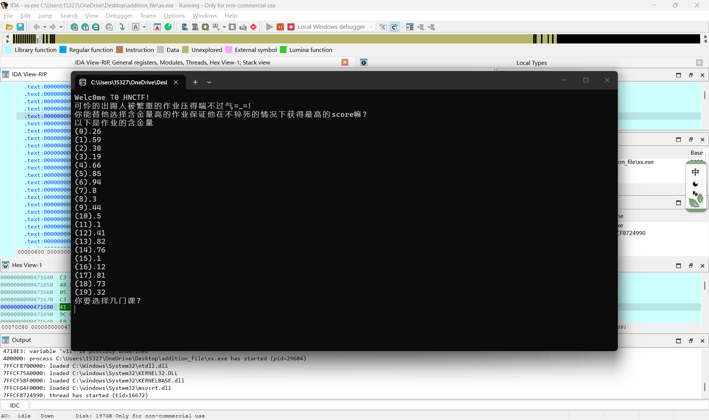

### 基础算法
#### RSA
RSA是一种非对称加密，使用**一对公钥和一对私钥**加密和解密，它涉及到一些数学知识  
如果p,q是两个不同的素数，n=p*q  
欧拉函数**φn=(p-1)(q-1)**，意义是小于n，且和n互质的整数的个数  
密钥的选取  
选两个素数p,q,**必须满足p<q**  
n=p*q  
欧拉函数φn=(p-1)(q-1)  
选取公钥e **1<e<φn**，且gcd(e,φn)=1  
选取私钥d e.d===1，即**d是e在模φn的模逆元**  
如果明文是m 
加密: **c=m的e次方mod n**  
解密: **m=c的d次方mod n**  
python代码  
import math  
def gcd(a,b):  
    while b:  
        a,b=b,a%b  
    return a  
def modinv(a,m):  
    g,x,y=extended_gcd(a,m)  
    if g!=1:  
        raise Exception('逆元不存在')  
    else:  
        return x%m  
def extended_gcd(a,b):  
    if b==0:  
        return (a,1,0)  
    else:  
        g,x1,y1=extended_gcd(b,a%b)  
        x = y1  
        y = x1-(a//b) * y1  
        return (g,x,y)  
def rsa_encrypt(m,e,n):  
    return pow(m,e,n)  
def rsa_decrypt(c,d,n):  
    return pow(c,d,n)  
p=11  
q=13  
n=p*q  
ola=(p-1)*(q-1)  
e=7  
d=modinv(e,ola)  
m=20  
c=rsa_encrypt(m,e,n)  
m2=rsa_decrypt(c,d,n)  
print(f"\n明文 m = {m}")  
print(f"加密后密文 c = {c}")  
print(f"解密还原 m' = {m2}")  
平时写代码时可以直接手搓函数直接使用，但是查阅资料发现，正规的写法应该是引用三方库随机生成随机密钥

#### DFS,BFS
分别是两种不同的**遍历**方式，DFS是深度优先遍历:**访问当前节点后，依次遍历它所有相邻节点，如果发现没访问过就使用递归**，使用的结构是栈  
BFS是广度优先遍历:**起点入队，标记队首，出队后再遍历邻接点，如果没有访问就再入队，以此类推**,使用的结构是队列  
拿一道题目为例子分析二者代码区别  
[HNCTF 2022 WEEK4]ez_maze 解包，反编译后后得到源码，发现是一个迷宫，用wsad控制方向，只能走值为0的位置  

bfs代码,**dir是把wsad对应成二维数组里执行的动作,er,ec是确认终点的位置**  
**后面visit是记录每一步执行后的位置(nr,nc)，q是记录每一步的路径，注意函数返回值都是两个变量**  
from collections import deque  
def bfs(maze,start,end=None):  
    dirs=[(-1,0,'w'), (1,0,'s'), (0,-1,'a'), (0, 1,'d')]  
    sr,sc=start  
    rows=len(maze)  
    cols=len(maze[0])  
    if end==None:  
        er,ec=None,None  
        for c in range(cols):  
            if(maze[rows-2][c]==0):  
                er,ec=rows-2,c  
    else:  
        er,ec=end  
    if er==None:  
        return None,'无终点'  
    q=deque()  
    q.append((sr,sc,""))  
    visit=set()  
    visit.add((sr,sc))  
    while q:  
        r,c,path=q.popleft()  
        if r==er and c==ec:  
            return path,'路径'  
        for dr,dc,sym in dirs:  
            nr=dr+r  
            nc=dc+c  
            if 0<=nr<rows and 0<=nc<cols:  
                if (maze[nr][nc]==0 and (nr,nc) not in visit):  
                    visit.add((nr,nc))  
                    q.append((nr,nc,path+sym))  
    return None,'无通路'  
start_pt=(1,1)
ans,msg=bfs(map1,start_pt)
print(msg)  
if ans:  
    print(ans)  
因为迷宫比较小，此处dfs的代码其实和bfs很相似，最关键的**不同**在于**容器q的操作,BFS是popleft(队列)，DFS是pop(栈)**  
实际运行时得到的结果是一直的，但是看别的题说DFS可能有**栈溢出**，只是这题没有遇到  
#### 贪心算法,动态规划
这里以**背包问题**举例子，因为我做题遇到的就是这个问题，后面还要就这个题对比两个算法  
假设存在不同的物品，每一个物品有不同的重量和不同价值，而且有一个重量的限制，研究的问题就是在不超过限制的前提下选择物品，使得价值取得最大值  
贪心算法就是**每一步都选当前局部最优的选项**  
动态规划是**计录每一个子问题的价值，再选择时参考记录进行遍历，遍历所有选择的组合之后，再选取最大值的组合**  
拿一道题目为例子分析二者代码区别  
[HNCTF 2022 WEEK3]Help_Me! IDA打开生成源码后，其实我一点思路也没有，尝试运行发现终端弹出了选择课程，尝试了多次发现超过**200**会猝死，这个200应该是一个限制

还是不会，后来参考了别的题解才发现原理是背包问题的贪心算法,动态规划，伪函数给的**初始两组数组**应该对应的就是**value,weight**  
贪心  发现贪心算法很直接，**item来记录每一个物品的性价比**,然后直接取值相加
value = [26, 59, 30, 19, 66, 85, 94, 8, 3, 44, 5, 1, 41, 82, 76, 1, 12, 81, 73, 32]  
weight = [71, 34, 82, 23, 1, 88, 12, 57, 10, 68, 5, 33, 37, 69, 98, 24, 26, 83, 16, 26]  
capacity = 200  
items = []  
for i, (v, w) in enumerate(zip(value, weight)):  
    items.append({'ratio': v/w, 'value': v, 'weight': w, 'index': i})  
items.sort(key=lambda x: x['ratio'], reverse=True)  
score = 0  
tired = 0  
sub = []  
for item in items:  
    if tired + item['weight'] <= capacity:  
        score += item['value']  
        tired += item['weight']  
        sub.append(item['index'])  
print(f"Score: {score}, Tired: {tired}, Sub:{sub}")  
动态规划  **dp[i][j]是最大的价值 path是选择的组合**,1为存在，0为不存在  
后面ij两次循环是为了**遍历所有可能的组合，不断更新dp和path的状态**  
遍历完后再取最佳的选择组合  
value = [26, 59, 30, 19, 66, 85, 94, 8, 3, 44, 5, 1, 41, 82, 76, 1, 12, 81, 73, 32]  
weight = [71, 34, 82, 23, 1, 88, 12, 57, 10, 68, 5, 33, 37, 69, 98, 24, 26, 83, 16, 26]  
cap = 200  
n = len(value)  
dp = [[0]*(cap+1) for _ in range(n+1)]  
path = [[0]*(cap+1) for _ in range(n+1)]  
for i in range(1, n+1):  
    v = value[i-1]  
    w = weight[i-1]  
    for j in range(1, cap+1):  
        if j >= w and dp[i-1][j - w] + v > dp[i-1][j]:  
            dp[i][j] = dp[i-1][j - w] + v  
            path[i][j] = 1  
        else:  
            dp[i][j] = dp[i-1][j]  
            path[i][j] = 0  
res = []  
j = cap  
for i in range(n, 0, -1):  
    if path[i][j] == 1:  
        res.append(i-1)  
        j -= weight[i-1]  
res.reverse()  
print(f"总价值：{dp[n][cap]}, 总重量：{sum(weight[x] for x in res)}")
print(f"下标：{res}")
### 动态调试
动态调试是使得程序**创建进程，加载内存，创建CPU运行指令**，IDA可以查看寄存器的值，查看内存里的数据等  
更为重要的是，其可以通过**单步走，暂停，修改寄存器/内存器等直接控制**程序的执行过程  
而"下断点"的意思是给CPU设置一个**到这里停下**的标记，此时在运行时CPU执行到这条指令时就会停下，我们就可以进行**控制/修改**操作  
还是以一道基础题为例子
#### [Reisen]NSSCTF2025入门题目-Debug  
查壳为没有壳,IDA打开后发现有一条汇编语言让你**按F2**下断点，先把主函数生成伪代码，发现伪代码里还有相同的**注释**  

把printf这条语句下断点，开启调试后，会发现进入了调试界面 按理说pressblocks函数只对a1执行了与操作，程序运行完这个函数后，应该查找的值是a1，但是在**Debug view**界面并没有查到  

后来把中间几步汇编语言查了一下才发现，程序已经把a1的值写入了寄存器里，在右上角寄存器查找a1的值，还真找到了flag的标签  

### 做题过程
