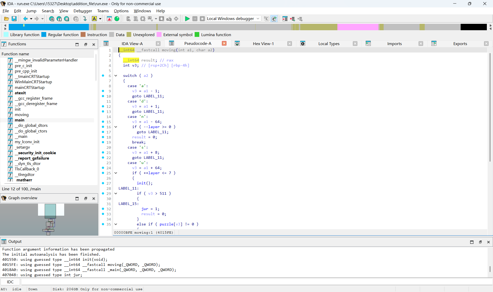

#### [GDOUCTF 2023]润！
查壳发现是有壳的，还让你尝试upx，直接尝试发现失败，于是想到核查壳的标志。使用**Imhex**工具查看标志字段被改了，**改回UPX字段**，再脱壳发现成功了。

查看代码的init函数发现生成了一个**puzzle**的数组，但是点击它并没有值，可以使用**动态调试**得到值    
在moving函数里发现**wsad控制，除此之外还有un控制**。目前不清楚un是什么，但能确定是个迷宫类问题

使用动态调试先获取puzzle数组，这里不需要步步调，把puzzle的地址记住就好，在init函数后面随便下一个断点，在**调试页面按G进行搜索**(复制粘贴puzzle的地址)发现puzzle已经运行出来了。

这个迷宫本身不对劲，查了别的题解才发现这个迷宫是**8*8*8三维的**，不是以前遇到的二维的。前面**un每步是+-64而不是1或8**，疑似是分别控制层数上下。  
现在需要把puzzle的进行整理输出，puzzle后面的gen有好多255,253之类的数据，但我不知道如何利用这些数据**输出每一层的二维数组**，借鉴脚本输出每一层的二维数组  
gen = [127, 127, 31, 223, 223, 255, 255, 255, 255, 255,  
       241, 255, 223, 255, 255, 255, 255, 255, 197, 223,  
       223, 255, 255, 255, 255, 255, 253, 255, 255, 255,  
       255, 255, 255, 253, 253, 253, 252, 255, 255, 255,  
       255, 255, 255, 255, 254, 254, 252, 249, 255, 255,  
       255, 255, 255, 255, 255, 251, 255, 255, 255, 255,  
       255, 255, 255, 248]  
conut = 0  
map = [0]*512  
for k in range(8):  
    for i in range(8):  
        for j in range(8):  
            map[8 * i + conut + 7 - j] = (gen[int(conut / 8) + i] >> j) & 1  
    conut += 64  
    for i in range(0+k*64,64+k*64,8):  
        print(map[i:i+8])  
    print('*'*50)

仔细想这个脚本好像也没那么难理解。输出数组后直接手动走一遍三维迷宫，得到路径ssddssuuwwddndduuussdussasauudd。这个手动的过程还是比较绕的
