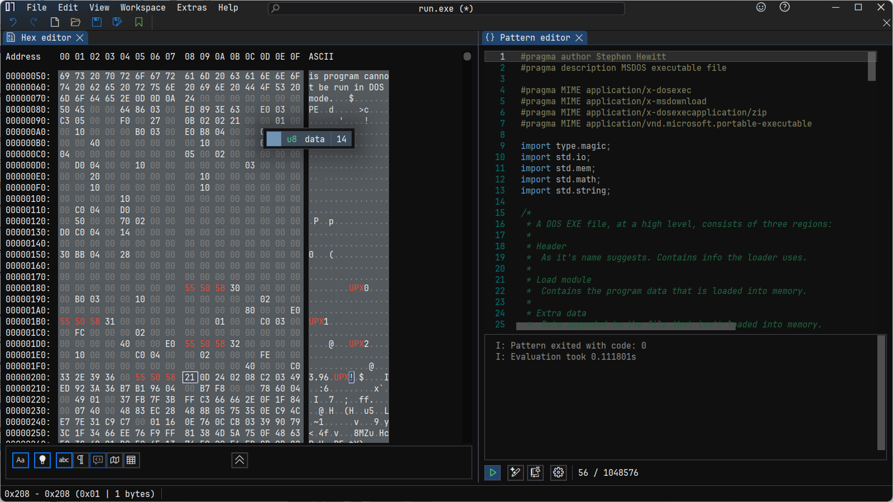
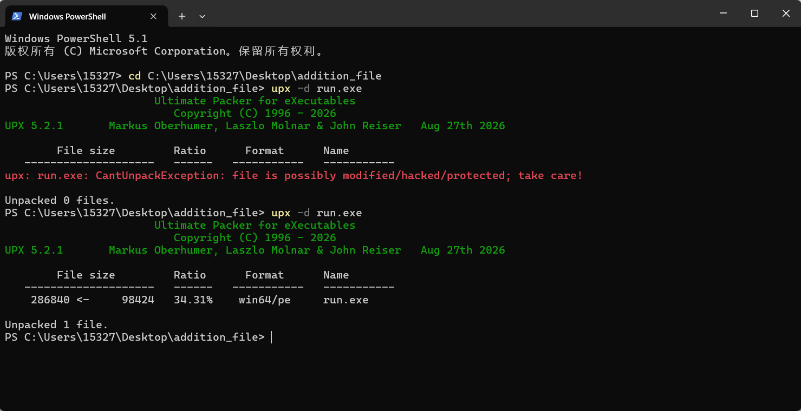
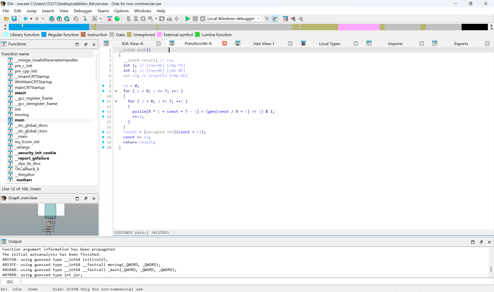
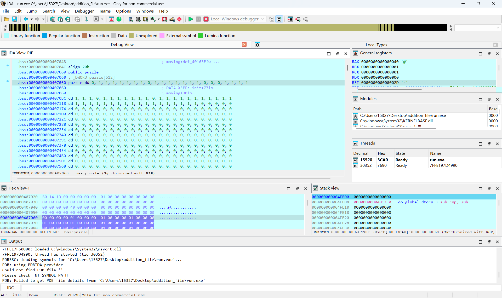
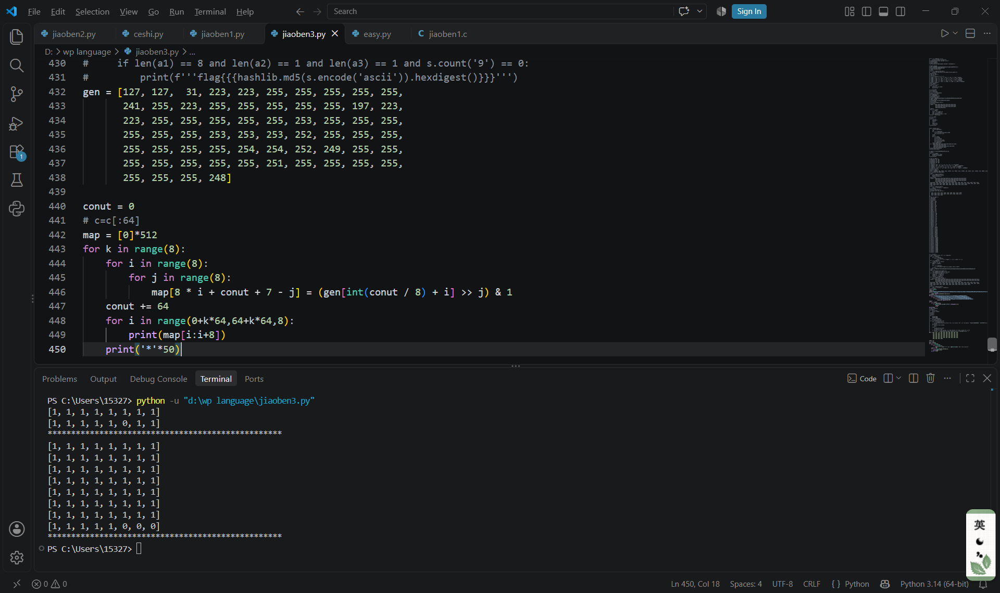

#### [GDOUCTF 2023]润！
查壳发现是有壳的，还让你尝试upx，直接尝试发现失败，于是想到核查壳的标志。使用**Imhex**工具查看标志字段被改了，**改回UPX字段**，再脱壳发现成功了。

查看代码的init函数发现生成了一个**puzzle**的数组，但是点击它并没有值，可以使用**动态调试**得到值    
在moving函数里发现**wsad控制，除此之外还有un控制**。目前不清楚un是什么，但能确定是个迷宫类问题

使用动态调试先获取puzzle数组，这里不需要步步调，把puzzle的**地址**记住就好，在init函数后面随便下一个断点，在**调试页面按G进行搜索**(**先复制puzzle的地址**)发现puzzle已经运行出来了。

这个迷宫本身不对劲，查了别的题解才发现这个迷宫是**8*8*8三维的**，不是以前遇到的二维的。前面**un每步是+-64而不是1或8**，疑似是分别控制层数上下。  
现在需要把puzzle的进行整理输出，puzzle后面的gen有好多255,253之类的数据，但我不知道如何利用这些数据**输出每一层的二维数组**，借鉴脚本输出每一层的二维数组  
gen = [127, 127, 31, 223, 223, 255, 255, 255, 255, 255,  
       241, 255, 223, 255, 255, 255, 255, 255, 197, 223,  
       223, 255, 255, 255, 255, 255, 253, 255, 255, 255,  
       255, 255, 255, 253, 253, 253, 252, 255, 255, 255,  
       255, 255, 255, 255, 254, 254, 252, 249, 255, 255,  
       255, 255, 255, 255, 255, 251, 255, 255, 255, 255,  
       255, 255, 255, 248]  
conut = 0  
map = [0]*512  
for k in range(8):  
    for i in range(8):  
        for j in range(8):  
            map[8 * i + conut + 7 - j] = (gen[int(conut / 8) + i] >> j) & 1  
    conut += 64  
    for i in range(0+k*64,64+k*64,8):  
        print(map[i:i+8])  
    print('*'*50)

仔细想这个脚本好像也没那么难理解。输出数组后直接**手动走一遍三维迷宫，得到路径ssddssuuwwddndduuussdussasauudd**。这个手动的过程还是比较绕的
#### [SWPUCTF 2024 秋季新生赛]动态调试
IDA打开后发现有个函数是**rc4_init**，可以判定考的函数是Rc4,后面**rc4_crypt**函数点进去看，发现和标准是一样的，key点击也能查看到，关键是不知道密文是什么   
最后的判断条件是**v2[j] != v1[j]**，前面的函数表明v2是用户输入的，Rc4的对象也是v2，**能做密文的只能是v1**，但是Rc4操作对象不是v1  
使用动态调试，在**rc4_crypt**下断点，尝试把v2的值修改为v1，运行后停在mov机器码处。发现**rdx, v2**这个机器码，**rdx寄存器应该存的就是v2的地址**  
之前先复制v1的地址，**把rdx的地址改成v1的**，再步步调试执行rc4_crypt，但是发现一直不对  
查了别人的题解，发现漏了一个关键信息是**r8d**，**该寄存器是存储密文的长度，而v1，v2长度并不一致，所以在修改时也必须修改长度**  
重新尝试，发现执行完rc4_crypt，v1的值已经改变，说明**v1被成功解密了**，把值chr变化就好了  
res = [0x4E, 0x53, 0x53, 0x43, 0x54, 0x46, 0x7B, 0x30, 0x64, 0x36,  
       0x66, 0x39, 0x30, 0x61, 0x63, 0x2D, 0x34, 0x62, 0x35, 0x65,  
       0x2D, 0x34, 0x65, 0x66, 0x62, 0x2D, 0x38, 0x35, 0x30, 0x32,  
       0x2D, 0x36, 0x33, 0x34, 0x39, 0x63, 0x66, 0x37, 0x39, 0x38,  
       0x66, 0x32, 0x65, 0x7D]  
for i in res:  
    print(chr(i), end='')
#### [SWPUCTF 2022 新生赛]贪吃蛇
IDA打开后，对main函数进行反编译，伪代码里有gameStartMenu，gameMainLoop，先分别查看一下两个函数，后一个函数应该是控制游戏进程，判断结果，输出结果等    
查找了半天发现_t_flag疑似是待输出的内容，而前面的校验语句有点复杂。关键是如何通过动态调试跳过校验或者是修改逻辑  
先直接运行观察逻辑，发现jz short loc_401BF3的**跳转语句**，**左边是isflag的输出语句，右边是gameover的语句**，在**jz short loc_401BF3**处下断点，观察运行  
运行直接让蛇死掉，发现程序**执行到jz short loc_401BF3停下了**，此时发现**闪烁的是右边的线段，说明前面的校验结果生效了**  
此时可以直接**修改ZF的值**来修改校验结果，此时的ZF为1(校验结果生效)，改成0，会发现**闪烁的是左边的线段，说明修改成功，校验结果已经不生效**。再点运行会输出flag  
**ZF本身是用于表示判断的结果，在断点处修改ZF等于说直接修改了前面的判断结果，使得程序原本的分支发生变化，执行的模块随之发生改变**
