### JVM 字节码
字节码是JAVA虚拟机规定的指令集，这种二进制指令是java源码编译得到的，不是原生CPU的X86机器码  
字节码是基于栈的：运算指令从操作数栈顶弹出操作数、结果压回栈  
每一个字节opcode的含义是规定好的，这里拿一段java代码举例    
.java文件名必须与 public 类名一致    
public class ceshi {  
    public static int sum(int n) {  
        int s = 0;  
        int i = 1;  
        while (i <= n) {  
            s = s + i;  
            i = i + 1;  
        }  
        return s;  
    }  
    public static void main(String[] args) {  
        int ans = sum(10);  
        if (ans > 40) {  
            System.out.println("大于40");  
        } else {  
            System.out.println("小于等于40");  
        }  
    }  
}  
保存为.java文件后，先编译javac ceshi.java，得到ceshi.class编译文件，再反汇编javap -c ceshi.class，在终端成功看到了输出结果
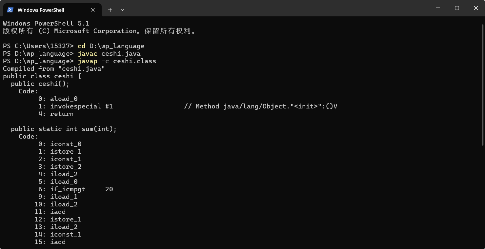
Compiled from "ceshi.java"
public class ceshi {
  public ceshi();
    Code:
         0: aload_0
         1: invokespecial #1                  // Method java/lang/Object."<init>":()V
         4: return
  public static int sum(int);
    Code:
         0: iconst_0
         1: istore_1
         2: iconst_1
         3: istore_2
         4: iload_2
         5: iload_0
         6: if_icmpgt     20
         9: iload_1
        10: iload_2
        11: iadd
        12: istore_1
        13: iload_2
        14: iconst_1
        15: iadd
        16: istore_2
        17: goto          4
        20: iload_1
        21: ireturn
  public static void main(java.lang.String[]);
    Code:
         0: bipush        10
         2: invokestatic  #7                  // Method sum:(I)I
         5: istore_1
         6: iload_1
         7: bipush        40
         9: if_icmple     23
        12: getstatic     #13                 // Field java/lang/System.out:Ljava/io/PrintStream;
        15: ldc           #19                 // String 大于40
        17: invokevirtual #21                 // Method java/io/PrintStream.println:(Ljava/lang/String;)V
        20: goto          31
        23: getstatic     #13                 // Field java/lang/System.out:Ljava/io/PrintStream;
        26: ldc           #27                 // String 小于等于40
        28: invokevirtual #21                 // Method java/io/PrintStream.println:(Ljava/lang/String;)V
        31: return
}
分析每一处opcode操作码
iconst 压栈  
istore 存储  
iload 加载int  
if_icmpgt比较 前>后跳转  
goto 跳转  
ireturn 返回int  
bipush 入栈(单字节）
if_icmple 比较 “前<=后跳转  
ldc 加载常量  
 invokevirtual 调用方法  
除此之外的常见opcode操作码  
irem int取模  
ineg int 取负  
iinc 自增  
new 新建对象  
getfield 获取实例字段  
putfield 设置实例字段  
instanceof 判断类型  
字节码对于数据类型的要求很高，不能混用数据类型  
### 解题记录
#### [SWPUCTF 2025 秋季新生赛]ez_tea
IDA打开后，似乎找不到函数的位置，先shift F12寻找关键字，发现有一个wrong，在IDAview里选中它选择交叉引用(Ctrl+X)找到对应的函数
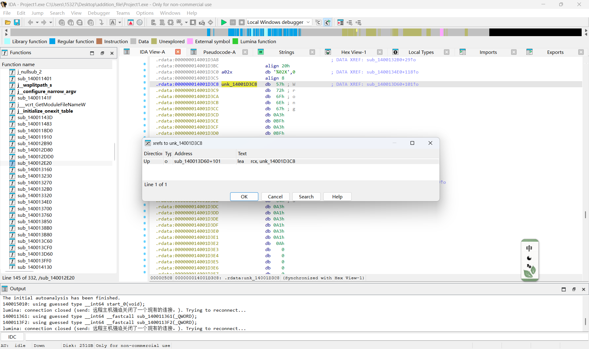
直接调试发现出现弹窗了，那么需要找到写入弹窗的函数，这里没有关键字只能一个一个反编译
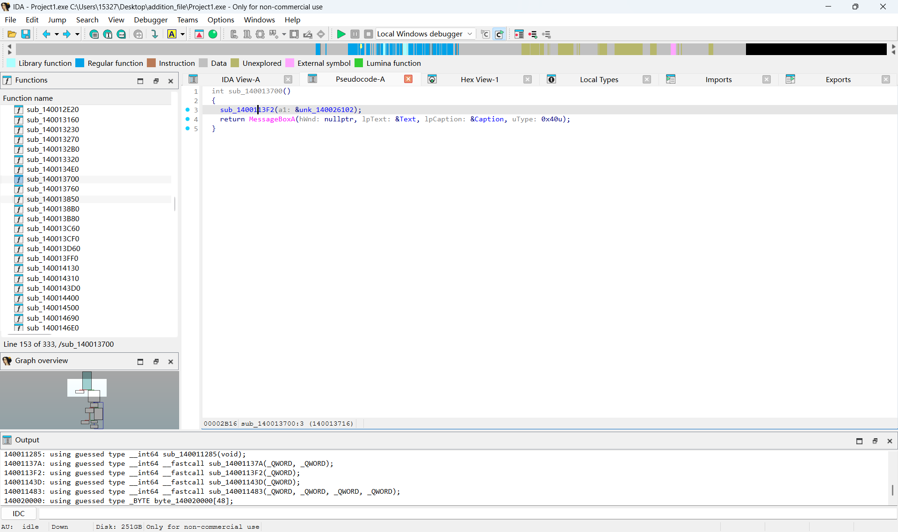
找到这个函数后，还是Ctrl+X交叉引用寻找调用调它的函数，在对应函数里找有关退出的机器指令，一共三处，把这三处指令全部nop掉
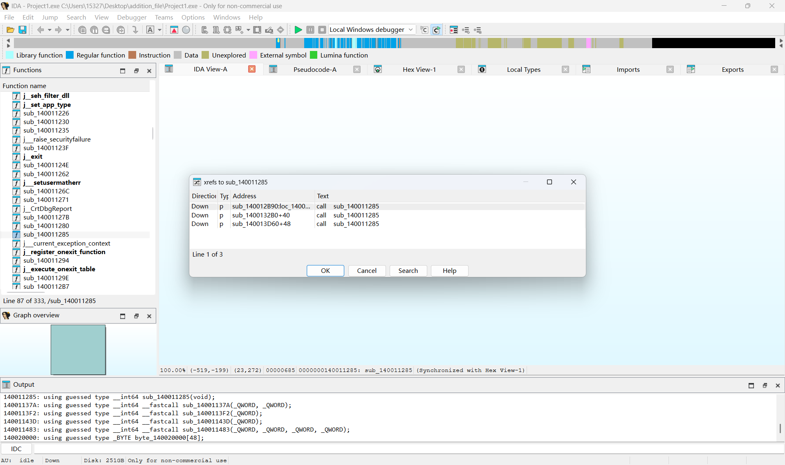
跑过反调试后，IDA 函数窗口里出现了之前没识别出的函数，说明程序已进入正常执行流程  
sub_7EF658DC1483是主函数，里面的sub_7FF65BDC38B0函数是tea加密,还有一个独立的函数sub_7FF65BDC3320是字符偏移
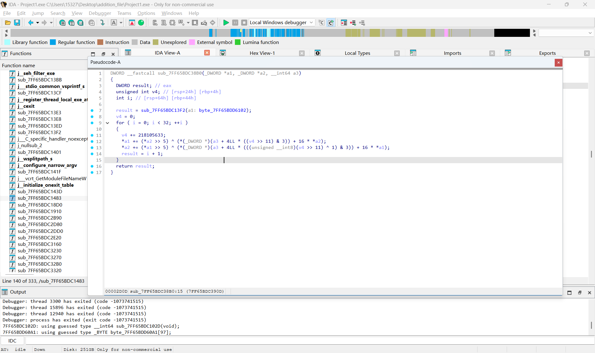
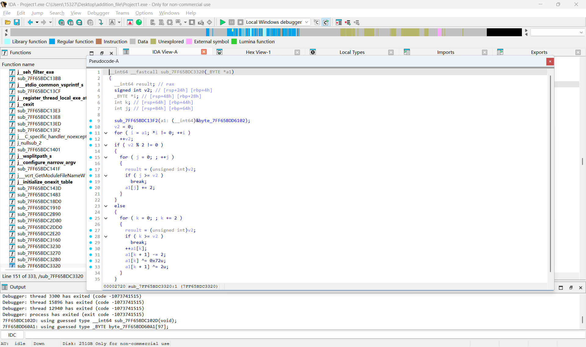
byte_7FF65BDD0000是密文，而密钥我怎么都找不到。看了别的题解才发现需要动态调试:
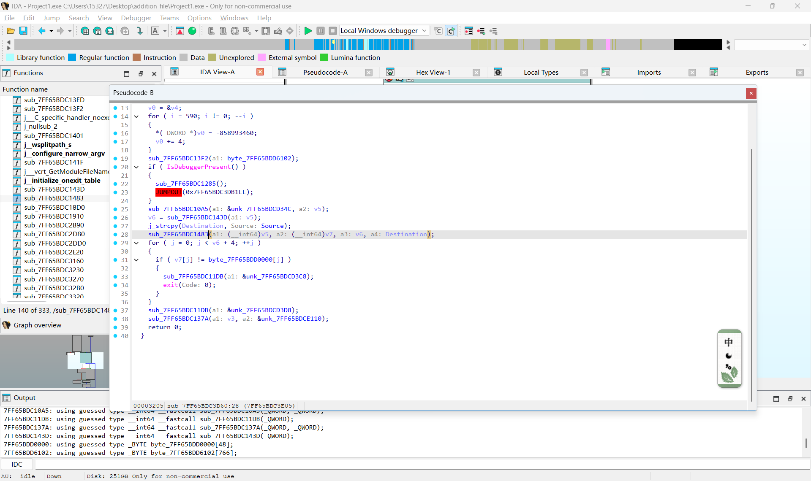
在sub_7EF658DC1483主函数Ctrl+X交叉引用，选第二处交叉引用，v6 = sub_7FF65BDC143D(a1: v5)下断点，跟踪v6的值,调试页面的v6即为密钥
据此进行tea解密和字符偏移，注意循环次数和字符偏移的执行顺序
#include <stdio.h>  
#include <stdint.h>  
#include <string.h>  
void decrypt(uint32_t rounds, uint32_t v[2], uint32_t const key[4])  
{  
    uint32_t v0 = v[0], v1 = v[1];  
    uint32_t delta = 0x0D000721;  
    uint32_t sum = delta * rounds;  
    for (uint32_t i = 0; i < rounds; i++)  
    {  
        v1 -= ((v0 >> 5) ^ (key[((sum >> 11) ^ 1) & 3] + (v0 << 4)));  
        v0 -= ((v1 >> 5) ^ (key[(sum >> 11) & 3] + (v1 << 4)));  
        sum -= delta;  
    }  
    v[0] = v0;v[1] = v1;  
}  
void string(uint8_t *buf)  
{  
    int len = strlen((char*)buf);  
    if (len % 2)  
    {  
        for (int i = 0; i < len; i++)  
            buf[i] -= 2;  
    }  
    else  
    {  
        for (int i = 0; i < len; i += 2)  
        {  
            buf[i]   ^= 0x72;  
            buf[i+1] ^= 0x02;  
            buf[i]   -= 1;  
            buf[i+1] += 2;  
        }  
    }  
}  
int main()  
{  
    uint8_t enc[] = {  
        0xE8, 0x1C, 0xEB, 0xDD, 0x91, 0x66, 0x69, 0x46,  
        0xFD, 0xF5, 0xBA, 0x47, 0xED, 0x25, 0xB6, 0x73,  
        0x99, 0xC4, 0x3D, 0xFD, 0xFB, 0x7E, 0x9E, 0x01,  
        0x40, 0x73, 0xF8, 0x9B, 0xB4, 0x48, 0x8B, 0xF2,  
        0x5A, 0xBE, 0x7F, 0xC0, 0x6E, 0xBE, 0x40, 0xD2,  
        0x6B, 0xFF, 0x91, 0xB0, 0xF8, 0x0B, 0x0F, 0x7D  
    };  
    uint32_t key[4] = {0x36433331,0x45344537,0x33314534,0x32373137};  
    uint8_t res[49] = {0};  
    uint32_t tmp[2];  
    for (int i = 0; i < 48; i += 8)  
    {  
        tmp[0] = *(uint32_t*)(enc + i);    
        tmp[1] = *(uint32_t*)(enc + i + 4);    
        decrypt(32, tmp, key);    
        memcpy(res + i, tmp, 8);     
    }    
    res[48] = 0;  
    string(res);  
    printf("%s\n", res);    
    return 0;   
}  
#### [GWCTF 2019]babyvm
在主函数sub_CD1里发现有好几处操作，但是每一步都占用独立的字节，也就是说函数本身定义了一个字节码，unk_202060存放了操作码  
在ida view里查看unk_202060，发现它的字节范围是从0x2060到0x229e，还有好几个操作码  
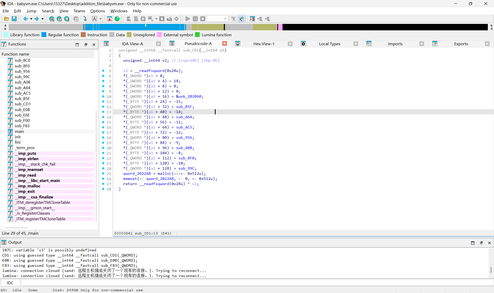  
每一个操作码执行的操作对应一个函数，需要翻译每一步操作  
0xf1 应该是mov操作，不同的分支执行不同的操作    
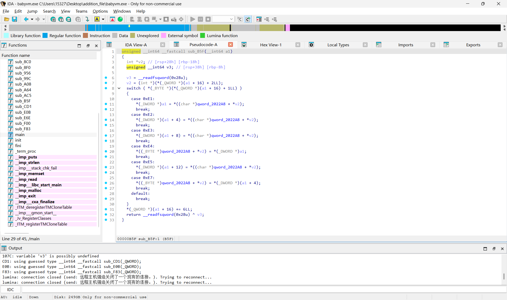
0xf2 异或操作R0=R0^R1  

0xf5 读取21长度的flag  
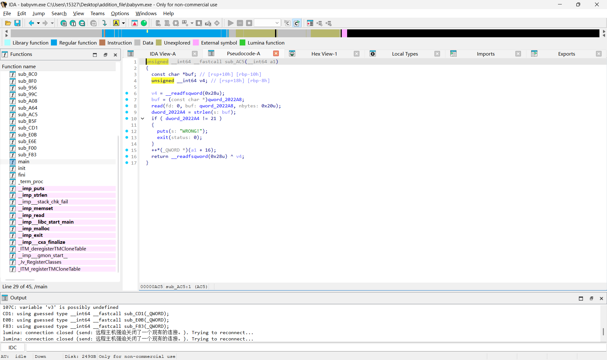
0xf4 不操作  
0xf7 乘法操作R0=R0乘以R3  
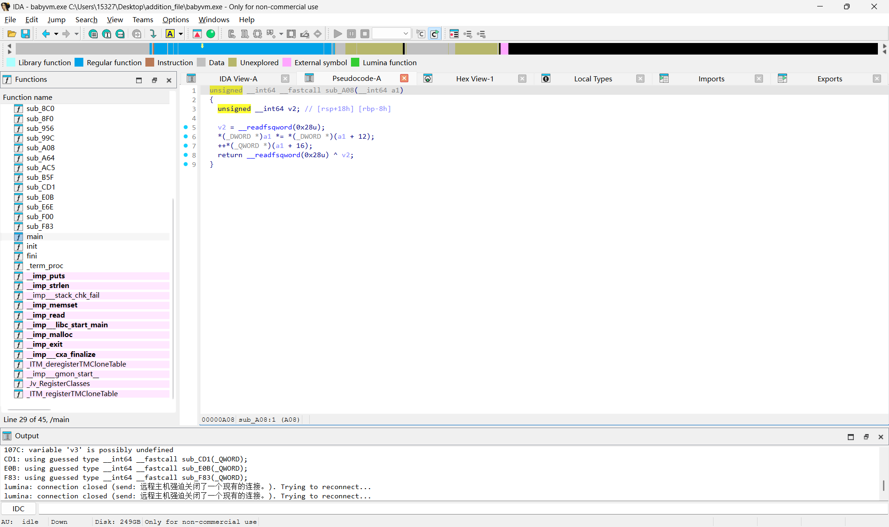
0xf8 交换操作 R1，R0互换  
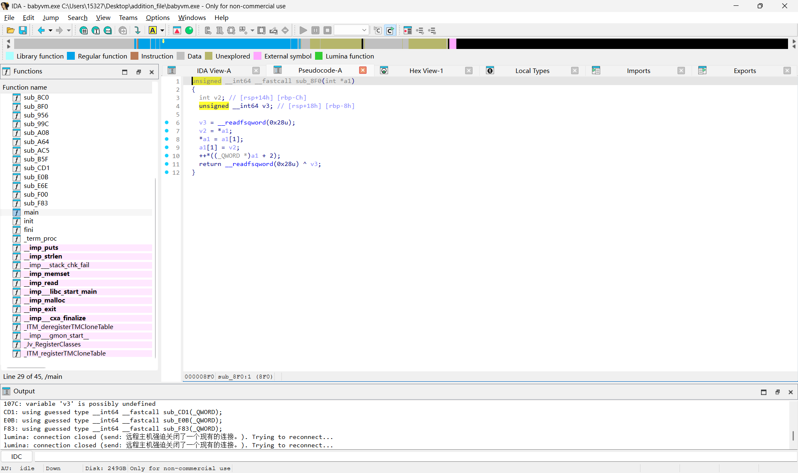
0xf6 线性计算 R0=R2+2R1+3R0  
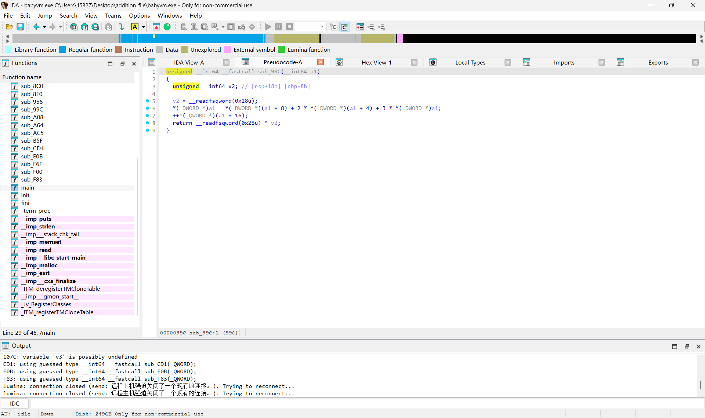
现在需要写代码获取整个sub_CD1对应的字节码，这里借鉴了别人的题解  
offset就是对应字节的位置，binascii.b2a_hex是转化为十六进制字符串，前面一段的意思就是读取0x2060到0x229e的所有数据 
存在文件偏移，此处0x2060 对应 VA0x202060  
arr存放字节码数组，result存放反汇编文本  
import binascii   
fd = open("C:/Users/15327/Desktop/addition_file/babyvm.exe", "rb")  
arr = []  
offset = 0x2060  
while offset <= 0x229e:  
    fd.seek(offset)  
    fr = fd.read(1)  
    arr.append(int(binascii.b2a_hex(fr).decode('utf-8'),16))  
    offset += 1  
result = ""  
i = 0  
while i < len(arr):  
    if arr[i] == 0xf1:  
        if arr[i + 1] == 0xE1:  
            result += "{0} mov R0 flag[{1}]\n".format(i, arr[i + 2])  
        elif arr[i + 1] == 0xE2:  
            result += "{0} mov R1 flag[{1}]\n".format(i, arr[i + 2])  
        elif arr[i + 1] == 0xE3:  
            result += "{0} mov R2 flag[{1}]\n".format(i, arr[i + 2])  
        elif arr[i + 1] == 0xE4:  
            result += "{0} mov flag[{1}] R0\n".format(i, arr[i + 2])  
        elif arr[i + 1] == 0xE5:  
            result += "{0} mov R3 flag[{1}]\n".format(i, arr[i + 2])  
        elif arr[i + 1] == 0xE7:  
            result += "{0} mov flag[{1}] R1\n".format(i, arr[i + 2])  
        i = i + 6  
    elif arr[i] == 0xf2:  
        result += "{0} xor R0 R1\n".format(i)  
        i += 1  
    elif arr[i] == 0xf5:  
        result += "{0} read flag 21\n".format(i)  
        i += 1  
    elif arr[i] == 0xf4:  
        i += 1  
    elif arr[i] == 0xf7:  
        result += "{0} mul R0 R3\n".format(i)  
        i += 1  
    elif arr[i] == 0xf8:  
        result += "{0} swap R0 R1\n".format(i)  
        i += 1  
    elif arr[i] == 0xf6:  
        result += "{0} mov R0 R2+2*R1+3*R0\n".format(i)  
        i += 1  
    else:  
        i += 1  
with open(r"D:\babyvm.txt", "w", encoding="utf-8") as f:
    f.write(result)
在D:babyvm.txt成功获取字节码  
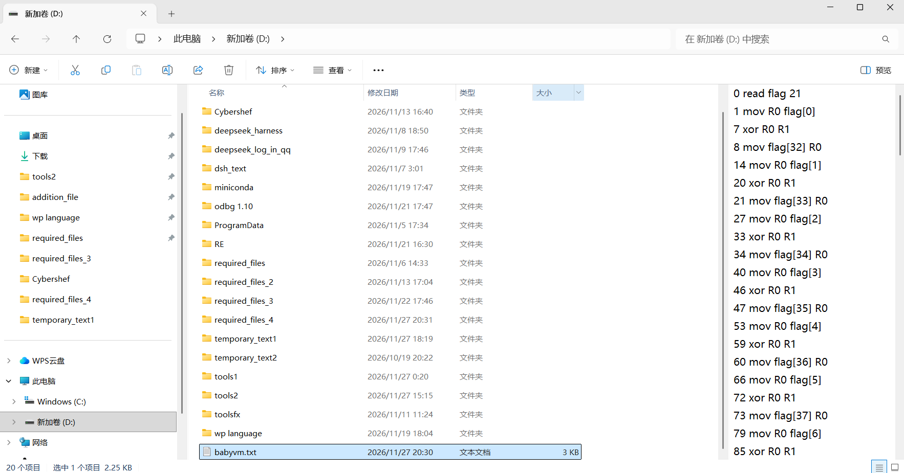  
解读字节码，这里有两段read flag，只有一段是和flag长度相符合的    
字节码的含义是13,19下标互换，14,18下标互换,15,17下标互换       
6下标=8下标+2乘以7下标+3乘以6下标，整体乘以12下标     
7下标=9下标+2乘以8下标+3乘以7下标，整体乘以12下标   
8下标=10下标+2乘以9下标+3乘以8下标，整体乘以12下标  
真正的校验是sub_F00位置，byte_202020是密文  
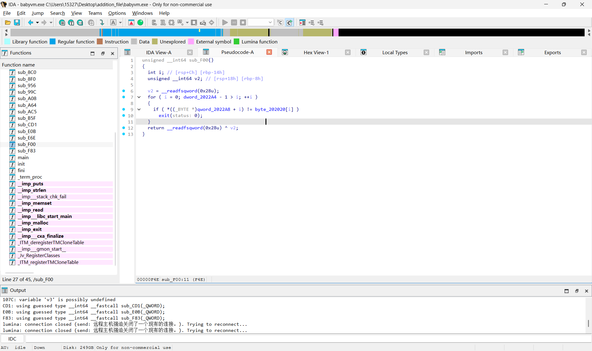
根据前面的字节码进行解密，注意暴力枚举时i的范围必须是ASCII值的范围
re=[105, 69, 42, 55, 9, 23, 197, 11, 92, 114, 51, 118, 51, 33, 116, 49, 95, 51, 115, 114]  
flag = []  
for i in range(20):  
    flag.append(0)  
flag[11] = re[11]  
flag[12] = re[12]  
flag[13] = re[19]  
flag[14] = re[18]  
flag[15] = re[17]  
flag[16] = re[16]  
flag[17] = re[15]  
flag[18] = re[14]  
flag[19] = re[13]  
flag[9] = re[9]  
flag[10] = re[10]  
for i in range(128):
    if re[8] == ((i * 3 + flag[9] * 2 + flag[10]) * flag[12]) & 0xff:  
        flag[8] = i  
        for j in range(128):  
            if re[7] == ((j * 3 + flag[8] * 2 + flag[9]) * flag[12]) & 0xff:  
                flag[7] = j  
                for k in range(128):  
                    if re[6] == ((k * 3 + flag[7] * 2 + flag[8]) * flag[12]) & 0xff:  
                        flag[6] = k  
flag[5] = re[5] ^ flag[6]  
flag[4] = re[4] ^ flag[5]  
flag[3] = re[3] ^ flag[4]  
flag[2] = re[2] ^ flag[3]
flag[1] = re[1] ^ flag[2]
flag[0] = re[0] ^ flag[1]
value = ""
for i in flag:
    value += chr(i)
print(value)
