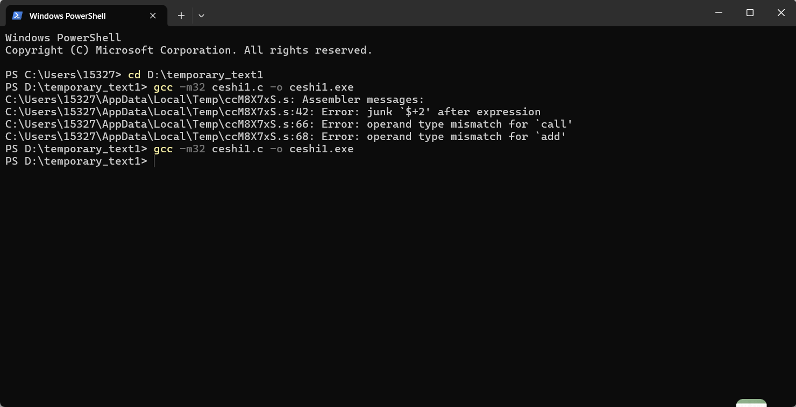
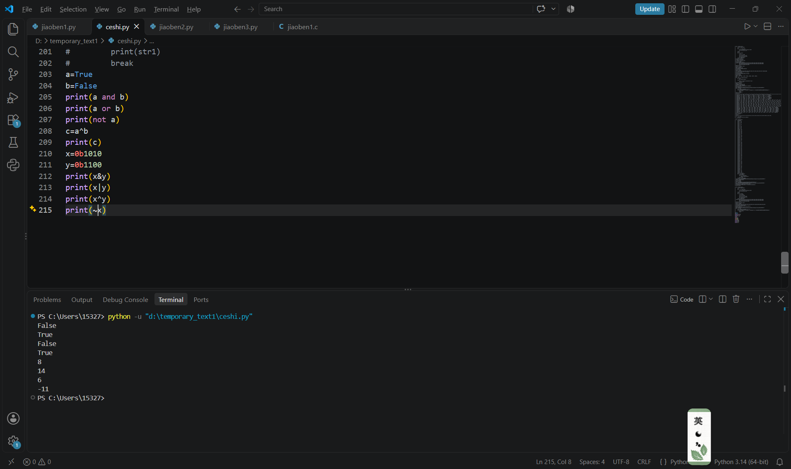
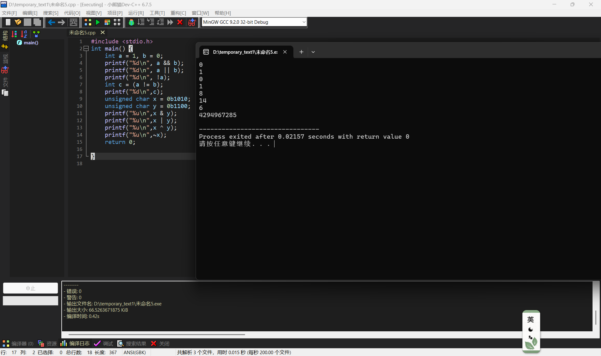

### 基本汇编语言
`Mov` 数据由原位置复制到目的位置，原操作数和目的操作数数据类型必须一致，**必须使用寄存器中转**  
`JMP` 直接跳转到指定目标继续执行，**不进行任何判断**，修改指令指针寄存器，修改代码寄存器的值实现跳转  
`JP` 条件跳转 检测CPU状态寄存器，奇偶标志位**PF=1**时跳转，反之为零就不跳转  
`Push` 入栈指令 CPU减小栈指针。数据写入新的栈顶位置  
`Pop` 出栈指令 读取当前栈指针指向的数据，把栈指针的值更新到栈顶  
`ADD` 加法  
`SUB` 减法  
`INC` 自增1  
`DEC` 自减1  
`MUL` 乘法  
`DIV` 除法  
`CMP` 比较  
`AND` 与  
`OR` 或  
`XOR` 异或  
`NOT`取反  

### 花指令
研究花指令的时候我弄混了魔术和操作码，机器指令的头字节叫opcode操作码，**只有这个头字节决定了执行那一条汇编语言**(汇编助记符) 其他字节不参与决定 
比如说，PUSH EAX的首字节是0x50，Pop  EAX是0x58,CALL是0XE8,Nop是**0x90**，前提必须是x86的CPU架构，且是32位程序，64位程序汇编语言的首字节也不同  
**CPU架构和操作系统是没关系的**，我开始也弄混了，x86是AMD的PC处理器，与之对应的是ARM，操作系统比如windows,Linux mac都是在CPU的系统软件  
有些教程提到把花指令nop掉，这个nop其实是汇编指令，不过该指令什么都不执行  
IDA就是读取二进制Opcode表(头字节)，解析成汇编语言让人看，花指令利用IDA解析的问题**构造一些字节**，在不影响CPU运行的前提下，使得IDA解析出错，函数和栈发生异常，所以花指令处会爆红，因为解析出错了
例子:  
`jmp  label+1 db 0xE8 label` 执行时jmp直接跳过了0xE8字节  
'jmp short $+2 db 0xC7' `$`是当前地址，`$+2`意味着跳过一个0xC7字节，如果改成+3，+4...会跳过更多字节  
`jz  next jnz next next`这个是条件跳转，不过jz,jnz**一定会有其中一个成立，一定会跳转到next**  
`call $+5`call直接**无条件**跳转，跳过后四个字节  
还有一些**无效的**堆栈操作，**无效的**运算
尝试在本地构造花指令，这个代码我不会写，抄了一遍AI写的    
#include <stdio.h>  
void junk1()  
{  
    __asm__(  
        "push eax\n"  
        "pop eax\n"  
        "jz label\n"  
        "jnz label\n"  
        "label:\n"  
    );  
}  
void junk2()  
{  
    __asm__(  
        "jmp short $+2\n"  
        ".byte 0xe8\n"  
    );  
}  
void junk3()  
{  
    __asm__(  
        "call $+5\n"  
        "pop eax\n"  
        "add eax, 0x10\n"  
    );  
}  
int main()  
{  
    junk1();  
    junk2();  
    junk3();  
    puts("hello my friend");  
    return 0;  
}

第一次编译报错了，AI解释说是内联汇编不兼容的问题，本地的GCC编译器不适配MSVC的汇编语言，修改后(AI提到强制切换汇编)编译成功  
很可惜，使用IDA打开后发现无爆红，观察发现IDA识别的函数全是**启动代码**之类的，**没有识别**junk123，应该还是代码本身的问题
### 基本逻辑运算，基本算法
#### 逻辑运算
逻辑与  两边都是真，真  
逻辑或 一边是真，真  
逻辑非 取反  
按位与 两个二进制都是1，1  
按位或 两个二进制只要有1，1  
按位异或 两个二进制不一样1，一样0  
按位取反 二进制按位取反  
C和Python的执行代码

| 运算   | C    | Python |
| :----: | :--: | :----: |
| 逻辑与 | `&&`   | `and`    |
| 逻辑或 | `\|\|` | `or`     |
| 逻辑非 | `!`    | `not`    |
| 按位与 | `&`    | `&`      |
| 按位或 | `\|`   | `\|`     |
| 按位异或 | `^`  | ^`      |
| 按位取反 | `~`  | `~`      |

使用C语言和python语言进行尝试，分析输出的结果是否符合预期

发现`unsigned char x = 0b1010`在按位取反运算时输出了4294967285,查资料发现运算`~x`时先把unsigned char类型(**8位**)升级为int类型(**32位**)，再按位取反，结果是0xFFFFFFFF5，使用**`%u`无符号32位整数**就是4294967285 
想获取8位的结果，必须把32位的数据与`0xFF`按位与，效果是**保留数据的最后低八位**，其他高位都变为零  
即**0xFFFFFFF5&0x000000FF=0xF5=245**
#### 算法
RC4:分为两个阶段，KSA，PRGA  
KSA是**密钥初始化**，S[]表示0-255的随机排列  
PRGA是**生成密文**，以S[]，明文为基础随机生成与明文等长的密文  
由于异或运算时可逆的，加密时**密文=明文^密钥**，解密时**明文=密文^密钥**  
python算法:  
def rc4(data,key):  
    s=list(range(256))  
    j=0  
    for i in range(256):  
        j=(j+s[i]+key[i%len(key)])%256  
        s[i],s[j]=s[j],s[i]  
    i=j=0  
    out=[]  
    for b in data:  
        i=(i+1)%256  
        j=(j+s[i])%256  
        s[i],s[j]=s[j],s[i]  
        k=s[(s[i]+s[j])%256]  
        out.append(b^k)  
    return bytes(out)  
AES:对称加密，分组固定为**128bit(16字节)**，包括四个基础变换  
字节代换:S盒替换字节  
行移位:矩阵行循环左移  
列混合:每一列和固定多项式强扩散  
密钥轮加:矩阵和当前密钥逐字节异或  
**以CBC模式为例，这里需要使用初始向量IV，密钥和IV的长度必须是16字节**  
python算法:
from Crypto.Cipher import AES  
from Crypto.Util.Padding import pad,unpad  
import os  
def aes_cbc_encrypt(plaintext: bytes,key:bytes,iv:bytes) -> bytes:  
    cipher=AES.new(key,AES.MODE_CBC,iv)  
    return cipher.encrypt(pad(plaintext,AES.block_size))  
def aes_cbc_decrypt(ciphertext: bytes,key: bytes,iv: bytes) -> bytes:  
    cipher=AES.new(key, AES.MODE_CBC, iv)  
    return unpad(cipher.decrypt(ciphertext),AES.block_size)  
key=b"1234567890123456"  
iv=os.urandom(16)  
msg=b"hello aes"  
cipher_data = aes_cbc_encrypt(msg,key,iv)  
plain_data = aes_cbc_decrypt(cipher_data,key, iv)  
print(iv.hex())  
print(cipher_data.hex())  
print(plain_data.decode())  
